# Progressive Delivery Lab

A hands-on Cloud-Native project focused on Kubernetes deployments, traffic management, progressive delivery, automated rollback, and application observability.

The goal of this project is to build a realistic release environment in which new application versions can be deployed gradually, evaluated using operational metrics, and automatically rejected when predefined health conditions are not met.

The environment is built incrementally around a containerized FastAPI application, Kubernetes, Argo Rollouts, Gateway API, HAProxy, Prometheus, Grafana, and k6. It demonstrates progressive releases, request-level weighted traffic routing, metric-based analysis, automated candidate abort, load testing, and recovery to a known-good application configuration.

---

## 1. Project Overview

This project simulates the release infrastructure of a cloud-native application.

The sample application, `orders-api`, represents a simplified order-processing service. Multiple application versions can be executed with different runtime configurations to simulate both healthy and unhealthy releases.

The infrastructure is built around Kubernetes, with an Ingress-based external access path and a Gateway API data plane provided by `cloud-provider-kind`.

The main objective is to demonstrate how a new application version can be introduced into an existing environment without immediately exposing all incoming traffic to it.

The intended release workflow is:

1. Build a new application version.
2. Deploy the new version alongside the stable version.
3. Gradually increase the traffic sent to the new version.
4. Monitor application health and performance.
5. Promote the release if all conditions are satisfied.
6. Automatically abort the release if errors or latency exceed acceptable thresholds.

**Current implementation status:** The application is managed by an Argo Rollout with five ready replicas. The latest verified stable runtime configuration is v5 (revision 21). Prometheus scrapes the application Pods through a ServiceMonitor, and Grafana provides a release-monitoring dashboard. Argo Rollouts uses its Gateway API traffic-routing plugin to manage weighted HTTP traffic through HAProxy. A k6 Constant Arrival Rate test verified the traffic split, and a sustained 500-second load test supplied enough request volume for all four Prometheus-backed AnalysisRuns to pass. The candidate was automatically promoted and the Rollout reached `Healthy` with five ready Pods.

---

## 2. Project Objectives

The main objectives of this project are:

- Build and containerize a configurable application.
- Deploy and manage application workloads using Kubernetes.
- Implement external HTTP access through Kubernetes Ingress.
- Understand the relationship between Ingress, Gateway API, HTTPRoute, and Kubernetes Services.
- Implement Canary deployments with Argo Rollouts.
- Integrate Gateway API and HAProxy for request-level weighted traffic routing.
- Integrate Prometheus metrics into deployment analysis.
- Implement automated release promotion and candidate abort.
- Simulate production failures and evaluate recovery behavior.
- Validate traffic distribution, latency, and error rates with k6.

The project is designed as a practical infrastructure engineering exercise rather than a collection of isolated tool demonstrations.

---

## 3. Architecture

### 3.1 Current Architecture

The environment runs on an Ubuntu host with Docker and a two-node Kubernetes cluster created using kind. The `orders-api` workload is managed by Argo Rollouts in the `progressive-delivery` namespace. The latest verified stable runtime configuration is v5, with five ready replicas.

Two independent external HTTP paths are available:

- `orders.test` is the original path through the `cloud-provider-kind` Ingress integration and Envoy. It is preserved as a baseline access path and is not used to validate weighted Canary traffic.
- `orders-haproxy.test` is routed through the HAProxy Gateway API implementation. Its HTTPRoute references the `orders-api-stable` and `orders-api-canary` Services, and the Argo Rollouts Gateway API plugin adjusts the backend weights during Canary progression.

Argo Rollouts maintains separate stable and canary Service selectors using the `rollouts-pod-template-hash` label. The Gateway API plugin updates the `orders-api-smoke` HTTPRoute to apply the configured request-level traffic weights. This allows the configured Canary weight to control HTTP request distribution rather than approximating traffic share by scaling ReplicaSets alone.

Prometheus is deployed through the `kube-prometheus-stack` Helm chart. A ServiceMonitor discovers the application Pods and scrapes their `/metrics` endpoint. The Rollout Pod-template hash is copied into Prometheus target labels, allowing metrics to be separated by ReplicaSet. Grafana visualizes request rate, HTTP 5xx error rate, P95 latency, and request volume.

Argo Rollouts uses an `AnalysisTemplate` with Prometheus queries to evaluate the latest Canary ReplicaSet after each configured weight. Each inline AnalysisRun receives the candidate Pod-template hash dynamically. Successful analysis allows the Canary to progress; a failed metric analysis aborts the candidate. k6 generates sustained traffic and checks the observed response versions, HTTP failures, latency, and dropped iterations.

```text
                    External Client
                          |
        +------------------+------------------+
        |                                     |
        v                                     v
  orders.test                     orders-haproxy.test
        |                                     |
Ingress Resource                       HAProxy Gateway
        |                                     |
cloud-provider-kind                    GatewayClass: haproxy
        |                                     |
kind-ingress-gateway                   orders-api-gateway
        |                                     |
      Envoy                          HTTPRoute: orders-api-smoke
        |                                     |
orders-api Service                  +---------+---------+
        |                            |                   |
        |                       Stable backend       Canary backend
        |                       weight: 100-w       weight: w
        |                            |                   |
        |                     orders-api-stable  orders-api-canary
        |                            |                   |
        +----------------------------+-------------------+
                                    |
                            Application Pods
                          stable and canary RS
                                    |
                        /metrics on each Pod
                                    |
                              ServiceMonitor
                                    |
                                Prometheus
                                  /      \
                                v        v
                              Grafana  AnalysisTemplate
                                          |
                                          v
                                      AnalysisRun
                                          |
                                  +--------+--------+
                                  |                 |
                              Success            Failure
                                  |                 |
                            Continue Canary    Abort Candidate

      Argo Rollouts Controller manages ReplicaSets, Services,
      Canary weights, and the Gateway API traffic-routing plugin.
```

The original `orders.test` route remains available for general endpoint checks. Traffic-split experiments and k6 validation must use `orders-haproxy.test`, because that hostname is attached to the HTTPRoute managed by Argo Rollouts.

### 3.2 Kubernetes Cluster

The local Kubernetes environment contains two kind nodes:

- `pd-lab-control-plane`: runs the Kubernetes control-plane components.
- `pd-lab-worker`: worker node where the application Pods are currently scheduled.

The cluster is named `pd-lab` and runs Kubernetes `v1.37.0` in the verified environment.

Application resources are deployed in:

```text
progressive-delivery
```

The Argo Rollouts controller is installed separately in:

```text
argo-rollouts
```

The HAProxy Ingress Controller and its Gateway API resources are installed in or associated with the `ingress-controller` and `progressive-delivery` namespaces, respectively.

### 3.3 Application Traffic Flow

The original access path is retained:

```text
Client
  |
  | HTTP request to orders.test
  v
Ingress: orders-api
  |
  v
cloud-provider-kind Gateway / HTTPRoute
  |
  v
Envoy data plane
  |
  v
ClusterIP Service: orders-api:80
  |
  v
Application Pods
```

The weighted traffic path is separate:

```text
Client
  |
  | HTTP request to orders-haproxy.test
  v
HAProxy Gateway: orders-api-gateway
  |
  v
HTTPRoute: orders-api-smoke
  |
  +---- weighted backendRefs ----+
  |                              |
  v                              v
orders-api-stable           orders-api-canary
  |                              |
Stable ReplicaSet             Canary ReplicaSet
  |                              |
  +---------- Application Pods --+
```

The Gateway API plugin updates the HTTPRoute weights, while Argo Rollouts updates the Service selectors to target the stable and candidate ReplicaSets. This separates external traffic management from application version management.

---

## 4. Technology Stack

| Name | Purpose | Status |
|---|---|---|
| Ubuntu Linux | Development environment | In use |
| Python 3.12 | Application development | In use |
| FastAPI | REST API implementation | In use |
| Uvicorn | ASGI application server | In use |
| Prometheus Python Client | Application metrics instrumentation | In use |
| Docker | Application containerization | In use |
| Kubernetes | Container orchestration | In use |
| kind | Local Kubernetes cluster | In use |
| kubectl | Kubernetes management | In use |
| Helm | Installation and configuration of Kubernetes charts | In use |
| cloud-provider-kind | Local Ingress and load-balancer integration | In use |
| Gateway API | GatewayClass, Gateway, and HTTPRoute resources for both access paths | In use |
| Envoy | HTTP data plane for the original `orders.test` path | In use |
| HAProxy Ingress Controller (Community) | Gateway API implementation and weighted HTTP routing | In use |
| Argo Rollouts Gateway API Plugin | Connects Rollout Canary weights to the HAProxy HTTPRoute | In use |
| Argo Rollouts Controller | Progressive delivery controller | In use |
| kubectl-argo-rollouts CLI | Command-line management of Rollout resources | In use |
| Prometheus Operator | Manages Prometheus resources and ServiceMonitor discovery | In use |
| Prometheus | Metrics collection, storage, and PromQL evaluation | In use |
| Grafana | Release monitoring dashboard | In use |
| ServiceMonitor | Discovers and configures scraping of application Pods | In use |
| AnalysisTemplate / AnalysisRun | Evaluates candidate health during Canary progression | In use |
| k6 | Constant Arrival Rate load testing and traffic-split validation | In use |

---

## 5. Repository Structure

The repository contains the FastAPI application, Kubernetes manifests, Gateway API and HAProxy configuration, monitoring resources, k6 load tests, recovery snapshots, and implementation screenshots.

```text
progressive-delivery/
├── app/
│   └── main.py
│
├── backup/
│   ├── state-1/
│   │   ├── orders-api-deployment.yaml
│   │   ├── orders-api-ingress.yaml
│   │   └── orders-api-service.yaml
│   ├── state-3/
│   │   └── rollout-before-analysis-integration.yaml
│   └── state-4/
│       ├── orders-api-ingress.yaml
│       ├── orders-api-rollout.yaml
│       └── orders-api-service.yaml
│
├── docs/
│   └── images/
│
├── k6/
│   └── traffic-split.js
│
├── k8s/
│   ├── namespace.yaml
│   ├── configmap-v1.yaml
│   ├── configmap-v2.yaml
│   ├── configmap-v3.yaml
│   ├── configmap-v3-bad.yaml
│   ├── configmap-v4.yaml
│   ├── configmap-v4-bad.yaml
│   ├── configmap-v5.yaml
│   ├── rollout.yaml
│   ├── rollout.yaml.bak
│   ├── service.yaml
│   ├── ingress.yaml
│   ├── analysis/
│   │   └── orders-api-analysis.yaml
│   ├── gateway/
│   │   ├── argo-rollouts-gateway-rbac.yaml
│   │   ├── argo-rollouts-plugin.yaml
│   │   ├── haproxy-gatewayclass.yaml
│   │   ├── haproxy-values.yaml
│   │   ├── orders-api-gateway.yaml
│   │   ├── orders-api-smoke-route.yaml
│   │   └── orders-api-traffic.yaml
│   ├── monitoring/
│   │   ├── values.yaml
│   │   ├── orders-api-servicemonitor.yaml
│   │   └── dashboards/
│   │       └── orders-api-release-dashboard.json
│   └── scenarios/
│       ├── rollout-v3-bad.yaml
│       └── rollout-v4-bad.yaml
│
├── Dockerfile
├── install.yaml
├── kind-config.yaml
├── requirements.txt
└── README.md
```

### Directory Description

**app/**

Contains the FastAPI application source code.

**k8s/**

Contains Kubernetes resource definitions. `rollout.yaml` is the active workload definition. Version-specific ConfigMaps provide runtime configurations. The `analysis/` directory contains Argo Rollouts AnalysisTemplates; `monitoring/` contains Helm values, the ServiceMonitor, and the exported Grafana dashboard; `gateway/` contains the HAProxy Gateway API, plugin, and RBAC resources; and `scenarios/` contains manifests used for controlled release and failure experiments.

**k6/**

Contains the k6 scenario used to generate a constant request arrival rate and count responses served by the stable and Canary application versions.

**backup/**

Contains snapshots of earlier Kubernetes states: the original Deployment, Service, and Ingress; the Rollout definition before analysis integration; and the workload resources preserved during a later state transition.

**docs/images/**

Contains screenshots documenting the cluster, Rollouts, monitoring stack, Gateway API and HAProxy configuration, traffic routing, k6 results, and release validation.

---

## 6. Application Design

### 6.1 Overview

The sample application is a lightweight REST API implemented using FastAPI.

Its purpose is to simulate an order-processing service and provide controllable application behavior for deployment experiments.

The application supports configurable runtime parameters through environment variables.

### 6.2 API Endpoints

| Endpoint       | Description                                          |
| -------------- | ---------------------------------------------------- |
| `GET /`        | Returns application information                      |
| `GET /version` | Returns the running application version and Pod name |
| `GET /healthz` | Liveness health check                                |
| `GET /readyz`  | Readiness health check                               |
| `GET /process` | Simulates order processing                           |
| `GET /metrics` | Exposes Prometheus metrics                           |

### 6.3 Runtime Configuration

The application behavior can be controlled using environment variables.

| Variable      | Default | Description                                    |
| ------------- | ------- | ---------------------------------------------- |
| `APP_VERSION` | `v1`    | Application version identifier                 |
| `ERROR_RATE`  | `0`     | Probability of generating an HTTP 500 response |
| `DELAY_MS`    | `0`     | Artificial processing delay in milliseconds    |

Example healthy configuration:

```env
APP_VERSION=v1
ERROR_RATE=0
DELAY_MS=0
```

Example unhealthy configuration:

```env
APP_VERSION=v2
ERROR_RATE=0.05
DELAY_MS=800
```

The second configuration simulates a version that produces approximately 5% HTTP 500 responses and adds 800 milliseconds of processing delay.

These parameters are intended for controlled testing and fault injection.

### 6.4 Application Metrics

The application is instrumented using the Prometheus Python Client.

The main metrics are:

```text
http_requests_total
http_request_duration_seconds
```

The request counter includes the following labels:

- Application name
- Application version
- HTTP method
- HTTP response status

The request duration metric is implemented as a Histogram to support latency percentile calculations.

The `/metrics` endpoint exposes the collected metrics in Prometheus exposition format.

---

## 7. Local Development

### 7.1 Requirements

The following tools are required:

- Ubuntu Linux
- Python 3.12
- Docker Engine
- kubectl
- kind

### 7.2 Create a Python Virtual Environment

```bash
python3.12 -m venv .venv

source .venv/bin/activate
```

Install dependencies:

```bash
pip install --upgrade pip
pip install -r requirements.txt
```

### 7.3 Run the Application

```bash
uvicorn app.main:app --host 127.0.0.1 --port 8000
```

The API documentation is available at:

```text
http://localhost:8000/docs
```

Basic endpoint verification:

```bash
curl http://localhost:8000/

curl http://localhost:8000/version

curl http://localhost:8000/healthz

curl http://localhost:8000/readyz

curl http://localhost:8000/process

curl http://localhost:8000/metrics
```

---

## 8. Docker Build and Execution

### 8.1 Build the Docker Image

Build the application image:

```bash
docker build -t orders-api:v1 .
```

Verify the image:

```bash
docker images | grep orders-api
```

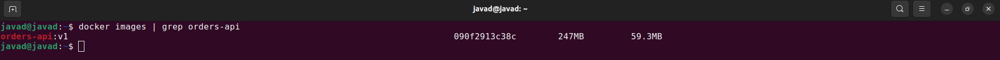


### 8.2 Run the Application Container

```bash
docker run --rm \
  --name orders-api-v1 \
  -p 8000:8000 \
  -e APP_VERSION=v1 \
  -e ERROR_RATE=0 \
  -e DELAY_MS=0 \
  orders-api:v1
```

### 8.3 Test Different Application Behaviors

The same application image can be executed with different environment configurations.

Healthy version:

```bash
docker run --rm \
  --name orders-api-v1 \
  -p 8000:8000 \
  -e APP_VERSION=v1 \
  -e ERROR_RATE=0 \
  -e DELAY_MS=0 \
  orders-api:v1
```

Fault-injected version:

```bash
docker run --rm \
  --name orders-api-v2 \
  -p 8001:8000 \
  -e APP_VERSION=v2 \
  -e ERROR_RATE=0.05 \
  -e DELAY_MS=800 \
  orders-api:v1
```

This allows different application behaviors to be tested without changing the application source code.

**Note:** The current Kubernetes environment uses the `orders-api:v1` image. Separate release image versions will be introduced in later stages.

---

## 9. Kubernetes Environment

### 9.1 Create the kind Cluster

The local Kubernetes cluster is created using kind.

Cluster configuration:

```yaml
kind: Cluster
apiVersion: kind.x-k8s.io/v1alpha4

nodes:
  - role: control-plane

  - role: worker
```

Create the cluster:

```bash
kind create cluster \
  --name pd-lab \
  --config kind-config.yaml
```

Verify the cluster:

```bash
kubectl get nodes -o wide
```
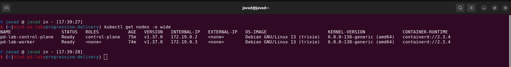

### 9.2 Load the Local Docker Image

Since the application image is built locally, it must be loaded into the kind nodes.

```bash
kind load docker-image \
  orders-api:v1 \
  --name pd-lab
```

Verify the image inside the kind nodes:

```bash
docker exec pd-lab-control-plane crictl images

docker exec pd-lab-worker crictl images
```

### 9.3 Namespace

All application resources are deployed in:

```text
progressive-delivery
```

Apply the Namespace:

```bash
kubectl apply -f k8s/namespace.yaml
```

### 9.4 Versioned ConfigMaps

Runtime configuration is separated from the container image using version-specific ConfigMaps.

| ConfigMap | `APP_VERSION` | `ERROR_RATE` | `DELAY_MS` | Purpose |
|---|---|---:|---:|---|
| `orders-api-v1-config` | `v1` | `0` | `0` | Initial stable configuration |
| `orders-api-v2-config` | `v2` | `0` | `0` | Healthy candidate used in the first Canary promotion |
| `orders-api-v3-config` | `v3` | `0` | `0` | Stable configuration used in the metric-driven automatic-abort experiment |
| `orders-api-v3-bad-config` | `v3-bad` | `1.0` | `800` | Earlier fault-injection profile used for manual Abort testing |
| `orders-api-v4-config` | `v4` | `0` | `0` | Healthy candidate configuration used during traffic-routing validation |
| `orders-api-v4-bad-config` | `v4-bad` | `1.0` | `800` | Fault-injection profile used to validate metric-driven automatic Abort |
| `orders-api-v5-config` | `v5` | `0` | `0` | Latest verified stable runtime configuration |

The v1 through v5 labels currently represent runtime configurations of the same `orders-api:v1` container image; they are not separate application builds. The bad configurations are test profiles. The v3-bad and v4-bad profiles make `/process` return HTTP 500 and add 800 ms of delay for requests handled by those candidates.

Apply the version-specific ConfigMaps as needed for a test:

```bash
kubectl apply -f k8s/configmap-v1.yaml
kubectl apply -f k8s/configmap-v2.yaml
kubectl apply -f k8s/configmap-v3.yaml
kubectl apply -f k8s/configmap-v3-bad.yaml
kubectl apply -f k8s/configmap-v4.yaml
kubectl apply -f k8s/configmap-v4-bad.yaml
kubectl apply -f k8s/configmap-v5.yaml
```

### 9.5 Argo Rollout

The original Kubernetes Deployment has been replaced by an Argo Rollout named `orders-api`.

The current Rollout configuration includes:

- Five desired replicas.
- Canary strategy with stages at 20%, 40%, 60%, and 80%.
- Inline Prometheus analysis after each configured Canary weight.
- `maxSurge: 1` and `maxUnavailable: 0`.
- Readiness and liveness probes.
- CPU and memory requests and limits.
- Non-root container execution and a read-only root filesystem.
- Dedicated `orders-api-stable` and `orders-api-canary` Services for Gateway API traffic routing.
- HAProxy HTTPRoute integration through the Argo Rollouts Gateway API plugin.
- Prometheus-backed Analysis after each configured Canary weight.

Apply the Rollout:

```bash
kubectl apply -f k8s/rollout.yaml
```

Check its status:

```bash
kubectl get rollout orders-api -n progressive-delivery

kubectl argo rollouts get rollout orders-api \
  -n progressive-delivery
```

Wait for the Rollout to become healthy:

```bash
kubectl argo rollouts status orders-api \
  -n progressive-delivery --watch
```

### 9.6 Kubernetes Service

The application remains exposed internally through a ClusterIP Service. The Service selector continues to match the Rollout Pod label `app: orders-api`.

```bash
kubectl apply -f k8s/service.yaml
```

The Service exposes port 80 and forwards traffic to the named application container port `http` (container port 8000).

Verify the Service and its ready endpoints:

```bash
kubectl get svc -n progressive-delivery

kubectl get endpointslice \
  -n progressive-delivery \
  -l kubernetes.io/service-name=orders-api
```

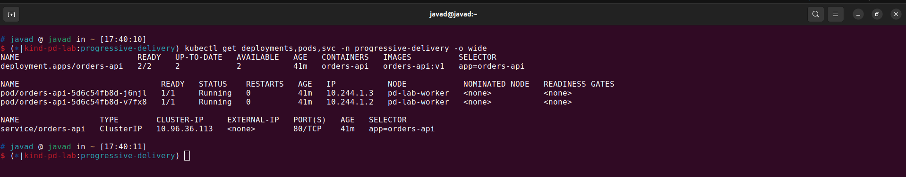

---

## 10. Ingress and External Access

### 10.1 Ingress Implementation

External HTTP access is implemented using the `cloud-provider-kind` integration.

The provider runs as a Docker container on the Ubuntu host and connects to the local kind cluster.

The deployment uses:

```text
cloud-provider-kind: v0.12.0
```

Container execution:

```bash
docker run -d \
  --name cloud-provider-kind \
  --restart unless-stopped \
  --network host \
  -v /var/run/docker.sock:/var/run/docker.sock \
  -v "$HOME/.kube:/root/.kube:ro" \
  -e KUBECONFIG=/root/.kube/config \
  registry.k8s.io/cloud-provider-kind/cloud-controller-manager:v0.12.0
```

### 10.2 Ingress Configuration

The application is exposed using the hostname:

```text
orders.test
```

Ingress configuration:

- Ingress Class: `cloud-provider-kind`
- Host: `orders.test`
- Path: `/`
- Backend Service: `orders-api`
- Backend Port: `80`

Apply the Ingress:

```bash
kubectl apply -f k8s/ingress.yaml
```

### 10.3 Original Gateway API Integration

The original Ingress configuration is translated into Gateway API resources by `cloud-provider-kind`.

The resulting architecture includes:

- GatewayClass: `cloud-provider-kind`
- Gateway: `kind-ingress-gateway`
- HTTPRoute generated for the `orders-api` Ingress
- Envoy as the HTTP data plane

This path serves `orders.test` and is preserved throughout the later HAProxy configuration. It provides a stable baseline access path but does not participate in the weighted Canary route.

Verify the original resources:

```bash
kubectl get ingress,gateway,httproute \
  -n progressive-delivery
```

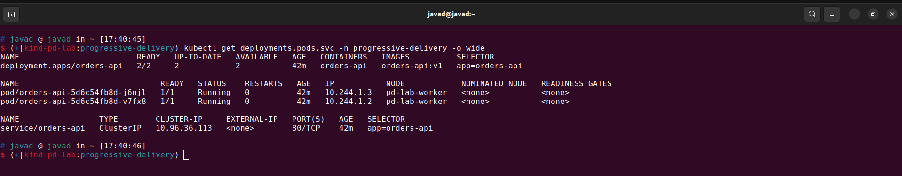

### 10.4 Local DNS Configuration for the Original Ingress

Retrieve the original Ingress IP:

```bash
INGRESS_IP=$(kubectl get ingress orders-api \
  -n progressive-delivery \
  -o jsonpath='{.status.loadBalancer.ingress[0].ip}')
```

Add the local hostname to `/etc/hosts`:

```bash
echo "$INGRESS_IP orders.test" | sudo tee -a /etc/hosts
```

The original application path is available at:

```text
http://orders.test
```

### 10.5 HAProxy Gateway API Path

A separate HAProxy Ingress Controller (Community) release is installed through Helm. The controller exposes a `LoadBalancer` Service, which receives an address from `cloud-provider-kind` in the local kind environment.

The HAProxy Gateway API resources are defined under `k8s/gateway/`:

| Resource | Name | Purpose |
|---|---|---|
| GatewayClass | `haproxy` | Selects the HAProxy Gateway API controller |
| Gateway | `orders-api-gateway` | HAProxy listener for the traffic-routing hostname |
| HTTPRoute | `orders-api-smoke` | Route for `orders-haproxy.test` and its weighted backends |

The Gateway uses the `haproxy` GatewayClass. The HTTPRoute attaches to `orders-api-gateway` and uses `orders-haproxy.test` as its hostname. Its initial smoke-test backend was the existing `orders-api` Service; the route was later updated to reference the stable and Canary Services.

The HAProxy controller can be installed with the repository's pinned chart configuration:

```bash
helm repo add haproxy-ingress \
  https://haproxy-ingress.github.io/charts

helm repo update

helm upgrade --install haproxy-ingress \
  haproxy-ingress/haproxy-ingress \
  --version 0.17.0-alpha.2 \
  --namespace ingress-controller \
  --create-namespace \
  -f k8s/gateway/haproxy-values.yaml
```

Apply the Gateway API resources:

```bash
kubectl apply -f k8s/gateway/haproxy-gatewayclass.yaml
kubectl apply -f k8s/gateway/orders-api-gateway.yaml
kubectl apply -f k8s/gateway/orders-api-smoke-route.yaml
```

Check controller and Gateway readiness:

```bash
kubectl get pods -n ingress-controller
kubectl get svc -n ingress-controller
kubectl get gatewayclass haproxy
kubectl get gateway orders-api-gateway -n progressive-delivery
kubectl describe httproute orders-api-smoke -n progressive-delivery
```

The expected HTTPRoute conditions are `Accepted=True` and `ResolvedRefs=True`.

Find the HAProxy LoadBalancer address and add the second hostname to `/etc/hosts`:

```bash
HAPROXY_IP=$(kubectl get svc haproxy-ingress \
  -n ingress-controller \
  -o jsonpath='{.status.loadBalancer.ingress[0].ip}')

echo "$HAPROXY_IP orders-haproxy.test" | sudo tee -a /etc/hosts
```

The HAProxy route is available at:

```text
http://orders-haproxy.test
```

The two paths are intentionally kept separate. `orders.test` continues through Envoy and the original `orders-api` Service. `orders-haproxy.test` enters the HAProxy Gateway and is the only path used to verify weighted Canary traffic.

<!-- SCREENSHOT 28 — HAProxy Controller
Capture the Helm release and the HAProxy controller Pod/LoadBalancer Service in the ingress-controller namespace.
Save as: docs/images/28-haproxy-controller.png

-->

<!-- SCREENSHOT 29 — HAProxy Gateway API Resources
Capture the `haproxy` GatewayClass, `orders-api-gateway` with Programmed=True, and the accepted HTTPRoute.
Save as: docs/images/29-haproxy-gateway-api-resources.png

-->

---

## 11. Verification and Testing

The environment is verified.

### 11.1 Kubernetes Cluster and Workload Verification

```bash
kubectl get nodes -o wide

kubectl get rollout -n progressive-delivery

kubectl get rs -n progressive-delivery

kubectl get pods -n progressive-delivery -o wide
```

The final verified workload state is one active ReplicaSet with five ready Pods. Older ReplicaSets remain at zero replicas as rollout history.

### 11.2 Ingress and Gateway Verification

```bash
kubectl get ingress,gateway,httproute \
  -n progressive-delivery
kubectl get gatewayclass
kubectl get pods,svc -n ingress-controller
```

The expected resources include:

- `orders-api` Ingress and `kind-ingress-gateway` for the original Envoy path.
- `haproxy` GatewayClass and `orders-api-gateway` for the HAProxy path.
- `orders-api-smoke` HTTPRoute with hostname `orders-haproxy.test` and accepted references.

### 11.3 External Application Access

The screenshot `05-ingress-access.png` records the initial v1 baseline. Later release tests promoted v2 and v3, followed by the Gateway API and k6 traffic-routing validation that promoted v5. The latest verified stable runtime configuration is v5.

Both external paths are accessible without `kubectl port-forward`. The original path and the weighted HAProxy path can be checked independently:

```bash
curl -i http://orders.test/

curl -i http://orders.test/version
curl -i http://orders-haproxy.test/version
```

The response identifies the runtime version and the Pod serving the request. `orders-haproxy.test` must be used for weighted traffic experiments. The latest verified stable configuration is `v5`, and the Pod name is assigned dynamically by Kubernetes:

```json
{
  "app": "orders-api",
  "version": "v5",
  "pod": "orders-api-..."
}
```

The Pod name is dynamically assigned by Kubernetes and can change after rescheduling or a new rollout.

### 11.4 Additional Endpoint Tests

```bash
curl -i http://orders.test/healthz

curl -i http://orders.test/readyz

curl -i http://orders.test/process

curl -s http://orders.test/metrics
```

### 11.5 Latest Verified State

The latest observed Rollout state after the Gateway API and k6 traffic-routing validation was revision 21:

| Component | Latest verified state |
|---|---|
| kind cluster | `pd-lab`, two nodes, Kubernetes `v1.37.0` |
| Argo Rollouts controller | `v1.10.1`, Running |
| `orders-api` Rollout | `Healthy`, revision 21 |
| Stable runtime configuration | `v5` |
| Active ReplicaSet | `orders-api-7dd5ff448`, five ready Pods |
| Previous ReplicaSet | `orders-api-66fc464c47`, scaled down |
| Inline AnalysisRuns for revision 21 | Four runs, all `Successful` |
| Original access path | `orders.test` through cloud-provider-kind and Envoy |
| Weighted access path | `orders-haproxy.test` through HAProxy Gateway API |
| HTTPRoute | `orders-api-smoke`, Accepted and ResolvedRefs |
| Traffic Services | `orders-api-stable` and `orders-api-canary` |
| Monitoring | Prometheus scraping application Pods; Grafana release dashboard available |
| Load testing | k6 Constant Arrival Rate test; sustained 500-second run completed the required analysis window |

The v5 label is a runtime configuration value selected through a ConfigMap. It is not a separate immutable Docker image build; the current lab still uses the `orders-api:v1` image for the versioned runtime profiles.

---

## 12. Argo Rollouts Controller and CLI

### 12.1 Overview

Argo Rollouts has been installed to introduce progressive delivery capabilities into the Kubernetes environment.

The installation currently includes:

- Argo Rollouts Custom Resource Definition (CRD).
- Argo Rollouts controller running in the `argo-rollouts` namespace.
- `kubectl-argo-rollouts` CLI installed on the Ubuntu host.

The controller and CLI are installed and operational. The `orders-api` workload has been migrated from a standard Kubernetes Deployment to an Argo Rollout. Canary promotion, manual Abort, and metric-driven candidate Abort have been exercised.

### 12.2 Installed Version

The controller and CLI use the same release version:

```text
Argo Rollouts: v1.10.1
```

The CLI reports the following build information:

```text
kubectl-argo-rollouts: v1.10.1+356117c
GitCommit: 356117c8e9a21b74b58c2c01d640aa91994522b5
Platform: linux/amd64
```

### 12.3 Install the Argo Rollouts Controller

Create a dedicated namespace:

```bash
kubectl create namespace argo-rollouts
```

Install the version-pinned release manifest:

```bash
kubectl apply \
  -n argo-rollouts \
  -f https://github.com/argoproj/argo-rollouts/releases/download/v1.10.1/install.yaml
```

Wait for the controller deployment to become available:

```bash
kubectl rollout status deployment/argo-rollouts \
  -n argo-rollouts \
  --timeout=180s
```

Verify the controller Pod:

```bash
kubectl get pods -n argo-rollouts
```


### 12.4 Verify the Custom Resource Definition

Argo Rollouts introduces the `Rollout` resource through a Kubernetes Custom Resource Definition.

Verify that the CRD is registered:

```bash
kubectl get crd rollouts.argoproj.io
```

List the available Rollouts API resource:

```bash
kubectl api-resources | grep -i rollout
```

The registered resource is `rollouts.argoproj.io`, with API version `v1alpha1`.

### 12.5 Install the kubectl Plugin

The `kubectl-argo-rollouts` binary is installed on the Ubuntu host. It provides commands for inspecting and managing Rollout resources.

For an AMD64 Ubuntu host, download the pinned release binary:

```bash
curl -fL \
  -o /tmp/kubectl-argo-rollouts \
  "https://github.com/argoproj/argo-rollouts/releases/download/v1.10.1/kubectl-argo-rollouts-linux-amd64"
```

Install the executable:

```bash
chmod +x /tmp/kubectl-argo-rollouts

sudo install -m 0755 \
  /tmp/kubectl-argo-rollouts \
  /usr/local/bin/kubectl-argo-rollouts
```

Verify the CLI:

```bash
kubectl argo rollouts version
```

<!-- 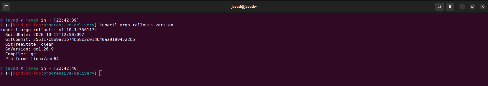 -->

### 12.6 Installation Verification

At the time of installation, the controller was verified while the application was still running as current Deployment. The Deployment check below records that initial state, before the later migration to an Argo Rollout:

```bash
kubectl get nodes

kubectl get pods -n progressive-delivery

kubectl get deployment orders-api -n progressive-delivery

kubectl get pods -n argo-rollouts

kubectl get crd rollouts.argoproj.io

kubectl argo rollouts version
```

The installation-time environment reported:

| Component | Verified state |
|---|---|
| kind control-plane node | `Ready`, Kubernetes `v1.37.0` |
| kind worker node | `Ready`, Kubernetes `v1.37.0` |
| `orders-api` workload at installation time | Original Deployment had `2/2` replicas available before migration |
| Argo Rollouts controller | `1/1` Pod ready |
| `rollouts.argoproj.io` CRD | Registered, `v1alpha1` storage version |
| `kubectl-argo-rollouts` | `v1.10.1+356117c`, `linux/amd64` |


---

## 13. Progressive Delivery with Argo Rollouts

### 13.1 Migration from Deployment to Rollout

Now we will replace `Deployment` with an Argo Rollout resource named `orders-api`.

Before the migration, snapshots of the original Deployment, Service, and Ingress were saved under `backup/state-1/`. The original Deployment was deleted before the Rollout was applied. This can cause a brief interruption while the new Pods become ready; it is a lab migration procedure, not a zero-downtime production migration strategy.

The Service and Ingress were preserved. The Rollout Pod template retained the `app: orders-api` label, so the existing Service selector continued to select the application Pods after the migration.

The active workload manifest is:

```text
k8s/rollout.yaml
```
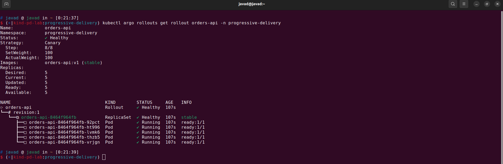

### 13.2 Version-Specific Runtime Configuration

The initial manual Canary exercise used separate ConfigMaps to model release configurations independently from the image:

| ConfigMap | `APP_VERSION` | `ERROR_RATE` | `DELAY_MS` | Purpose |
|---|---|---:|---:|---|
| `orders-api-v1-config` | `v1` | `0` | `0` | Initial stable configuration |
| `orders-api-v2-config` | `v2` | `0` | `0` | Healthy candidate promoted to stable |
| `orders-api-v3-bad-config` | `v3-bad` | `1.0` | `800` | Fault-injected candidate used for manual Abort testing |

These labels represent runtime configurations of the same image, `orders-api:v1`; they are not separate application builds. This isolates the behavior of the Rollout controller from changes to the application binary. The later metric-driven analysis tests use additional v3 and v4-bad configurations, documented in the Kubernetes and release-analysis sections.

### 13.3 Canary Strategy

The Rollout uses five desired replicas and progressively changes the Canary traffic weight:

```yaml
strategy:
  canary:
    stableService: orders-api-stable
    canaryService: orders-api-canary
    trafficRouting:
      plugins:
        argoproj-labs/gatewayAPI:
          httpRoute: orders-api-smoke
          namespace: progressive-delivery
    maxSurge: 1
    maxUnavailable: 0
    steps:
      - setWeight: 20
      - setWeight: 40
      - setWeight: 60
      - setWeight: 80
```

The active configuration also runs the `orders-api-canary-health` AnalysisTemplate after each configured weight. A timed pause is used at the first Canary stage to provide a test window for load generation and metric collection.

Unlike the earlier replica-based experiment, the current Gateway API integration implements request-level traffic weighting. Argo Rollouts manages the Service selectors so that `orders-api-stable` selects the stable ReplicaSet and `orders-api-canary` selects the candidate ReplicaSet. The Gateway API plugin then updates the HTTPRoute backend weights.

For example, at a Canary weight of 20%, the HTTPRoute is expected to contain:

| Backend Service | HTTPRoute weight |
|---|---:|
| `orders-api-stable` | 80 |
| `orders-api-canary` | 20 |

At subsequent steps, the expected stable/Canary weights are 60/40, 40/60, and 20/80. After successful analysis at all stages, the candidate is promoted and becomes the stable ReplicaSet.

The original `orders-api` Service remains available for the `orders.test` path. The weighted route uses `orders-api-stable` and `orders-api-canary` instead.

---

### 13.4 Start and Observe a Canary Release

To start a new candidate, the Rollout Pod template is changed to reference the candidate ConfigMap. For the v1-to-v2 experiment, the `envFrom` reference was changed from `orders-api-v1-config` to `orders-api-v2-config` while keeping the existing image.

Apply the Rollout manifest:

```bash
kubectl apply -f k8s/rollout.yaml
```

Watch the rollout:

```bash
kubectl argo rollouts get rollout orders-api \
  -n progressive-delivery --watch
```


Inspect the ReplicaSets and Pods:

```bash
kubectl get rs -n progressive-delivery

kubectl get pods -n progressive-delivery \
  -L rollouts-pod-template-hash
```

At each pause, inspect the reported stable and canary ReplicaSets before promoting the release.

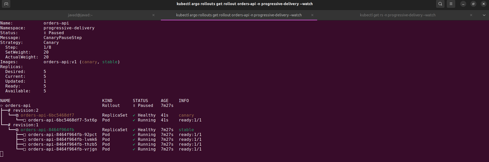
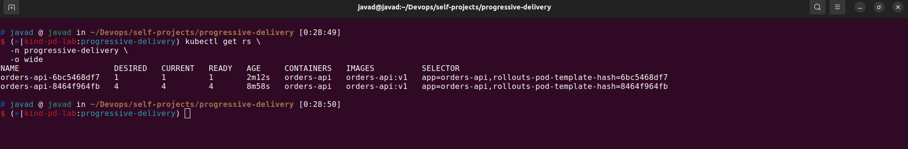


### 13.5 Manual Promotion

The Canary release was advanced manually through the configured 20%, 40%, 60%, and 80% steps.

At each indefinite pause, the next step was triggered with:

```bash
kubectl argo rollouts promote orders-api \
  -n progressive-delivery
```
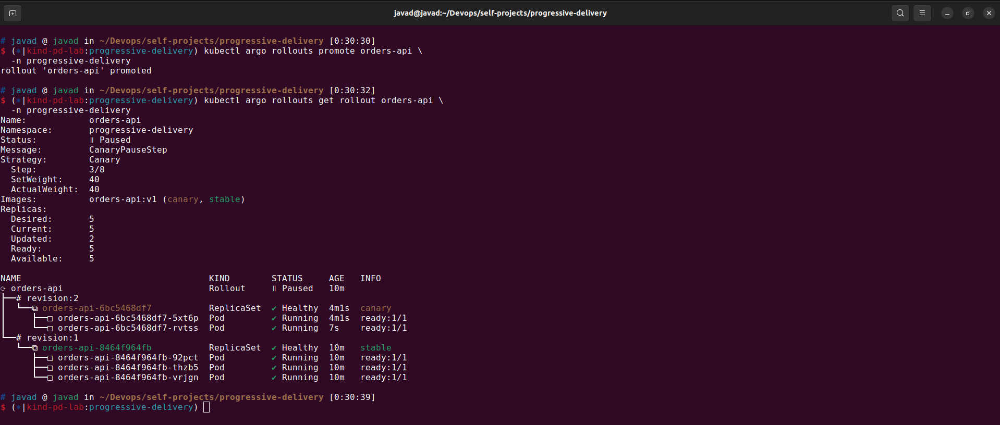
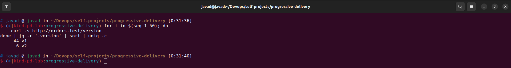


The command was repeated for each remaining pause. After the final step, the v2 candidate became the stable version and the Rollout reached a healthy state with five ready replicas.

Check the final status:

```bash
kubectl argo rollouts status orders-api \
  -n progressive-delivery --watch
```

```bash
kubectl get rollout orders-api -n progressive-delivery
```

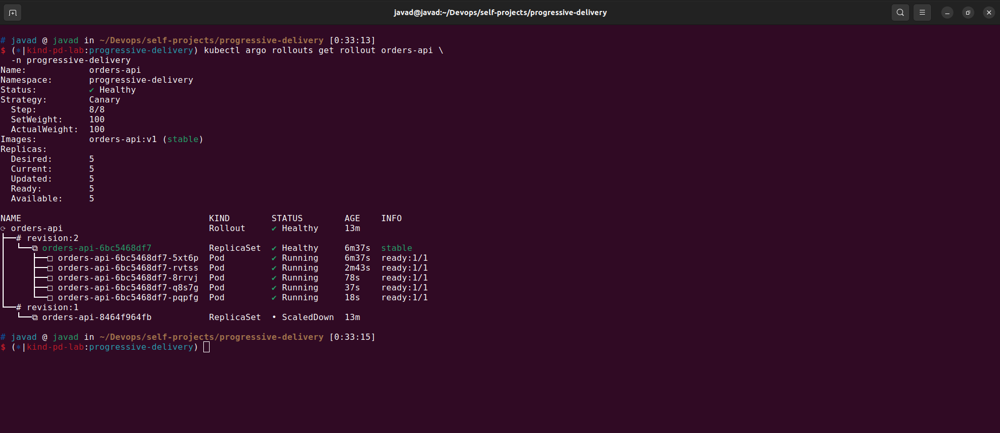
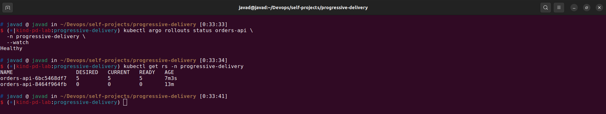


### 13.6 Manual Fault-Injection and Abort Test

An earlier fault-injection experiment used `orders-api-v3-bad-config` to simulate an unhealthy release:

```yaml
data:
  APP_VERSION: "v3-bad"
  ERROR_RATE: "1.0"
  DELAY_MS: "800"
```

This configuration affects the `/process` endpoint: requests handled by this candidate return HTTP 500 and include an additional 800 ms delay. Other endpoints such as `/version` are not configured to fail by these parameters.

The candidate was introduced by applying a scenario manifest:

```text
k8s/scenarios/rollout-v3-bad.yaml
```
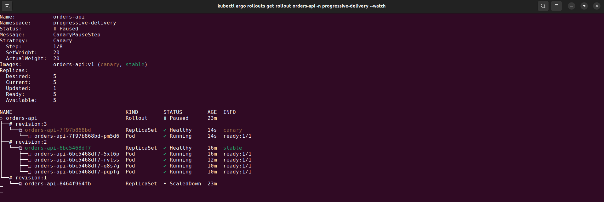

During the Canary pause, the candidate behavior was checked through the existing Ingress:

```bash
curl -i http://orders.test/version

curl -i http://orders.test/process
```

A batch of requests can be used to observe the response status distribution:

```bash
for i in $(seq 1 50); do
  curl -s -o /dev/null \
    -w '%{http_code}
' \
    http://orders.test/process
done | sort | uniq -c
```
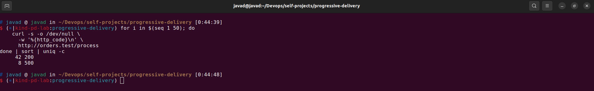

Because the Service distributes requests across the stable and candidate Pods, only requests reaching the fault-injected Pod are expected to fail during the partial Canary stage.

### 13.7 Manual Abort and Recovery to v2

The unhealthy candidate was stopped manually using the Argo Rollouts Abort command:

```bash
kubectl argo rollouts abort orders-api \
  -n progressive-delivery
```
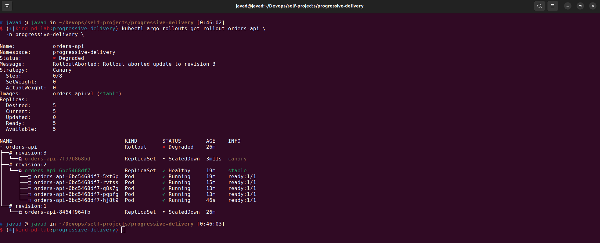

Abort stops the current rollout progression and returns serving capacity to the stable ReplicaSet. It does not, by itself, rewrite the Rollout's desired Pod template to the previous version. The desired state was therefore reconciled by re-applying the known-good v2 manifest, `k8s/rollout.yaml`, which references `orders-api-v2-config`:

```bash
kubectl apply -f k8s/rollout.yaml
```

Verify recovery:

```bash
kubectl argo rollouts status orders-api \
  -n progressive-delivery --watch

kubectl get rs -n progressive-delivery

kubectl get pods -n progressive-delivery -o wide

curl -i http://orders.test/version
```

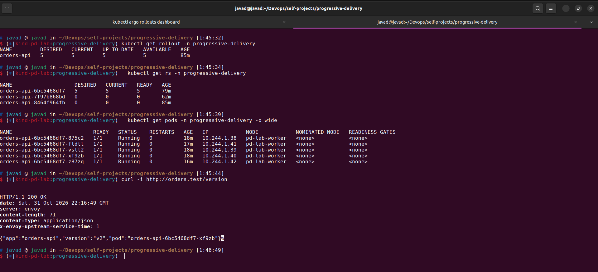
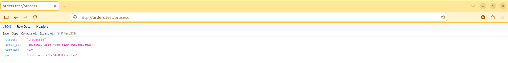


This earlier experiment demonstrated manual Abort and restoration of the v2 desired state. A later automated analysis test is documented in the following sections.

### 13.8 Rollout Inspection and Dashboard

Useful commands for inspecting the Rollout are:

```bash
kubectl get rollout orders-api -n progressive-delivery

kubectl argo rollouts list -n progressive-delivery

kubectl argo rollouts get rollout orders-api -n progressive-delivery

kubectl get rs -n progressive-delivery
```

The Argo Rollouts dashboard can be started locally with:

```bash
kubectl argo rollouts dashboard
```

The dashboard is normally available at:

```text
http://localhost:3100
```
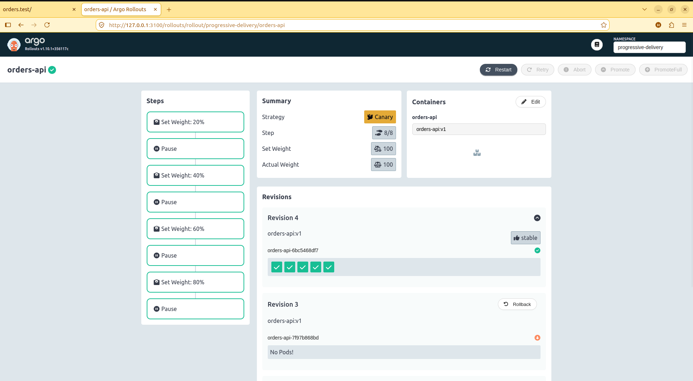


---

## 14. Prometheus and Grafana Observability

### 14.1 Monitoring Stack

Prometheus and Grafana are deployed using the `kube-prometheus-stack` Helm chart in the `monitoring` namespace.

Verified chart information:

| Component | Version / state |
|---|---|
| Helm release | `monitoring` |
| Chart | `kube-prometheus-stack` |
| Chart version | `92.17.0` |
| Chart appVersion | `v0.94.2` |
| Prometheus Operator | Running |
| Prometheus | Running |
| Grafana | Running |
| Alertmanager | Disabled for this environment |
| Node Exporter | Disabled for this environment |
| kube-state-metrics | Disabled for this environment |

The stack is intentionally kept small for the local kind environment. Prometheus uses a 12-hour retention period and no persistent volume is configured. Monitoring data is therefore disposable and is not intended to survive replacement of the local cluster or Prometheus Pod storage.

The Helm configuration is stored in:

```text
k8s/monitoring/values.yaml
```

The release can be installed or upgraded with:

```bash
helm repo add prometheus-community \
  https://prometheus-community.github.io/helm-charts

helm repo update

helm upgrade --install monitoring \
  prometheus-community/kube-prometheus-stack \
  --version 92.17.0 \
  --namespace monitoring \
  --create-namespace \
  -f k8s/monitoring/values.yaml \
  --wait \
  --timeout 10m
```

Verify the release and monitoring Pods:

```bash
helm list -n monitoring
kubectl get pods -n monitoring
kubectl get svc -n monitoring
```

<!-- SCREENSHOT 16 — Monitoring Stack
Capture `kubectl get pods -n monitoring` and show the Grafana, Prometheus Operator, and Prometheus Pods in Running/Ready state.
Save as: docs/images/16-monitoring-stack-pods.png

-->

### 14.2 Application Scraping with ServiceMonitor

The application exposes Prometheus metrics at `/metrics`. A ServiceMonitor selects the `orders-api` Service using the `monitoring: enabled` label and configures Prometheus to scrape the HTTP metrics endpoint every 10 seconds.

The ServiceMonitor is defined in:

```text
k8s/monitoring/orders-api-servicemonitor.yaml
```

The important configuration is:

```yaml
spec:
  namespaceSelector:
    matchNames:
      - progressive-delivery

  selector:
    matchLabels:
      monitoring: enabled

  podTargetLabels:
    - rollouts-pod-template-hash

  endpoints:
    - port: http
      path: /metrics
      interval: 10s
      scrapeTimeout: 5s
```

`podTargetLabels` copies the Rollout Pod-template hash into Prometheus target labels. Prometheus normalizes the label name to `rollouts_pod_template_hash`. This makes it possible to query metrics for one specific ReplicaSet rather than combining stable and candidate measurements.

Apply and inspect the ServiceMonitor:

```bash
kubectl apply -f k8s/monitoring/orders-api-servicemonitor.yaml

kubectl get servicemonitor -n progressive-delivery
kubectl describe servicemonitor orders-api -n progressive-delivery
```

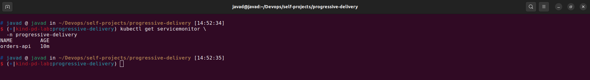


Prometheus is configured to discover ServiceMonitors across namespaces, so the `orders-api` monitor can be discovered even though Prometheus itself runs in the `monitoring` namespace.


### 14.3 Prometheus Target Verification

The application Pods are scraped individually. The target health query is:

```promql
up{namespace="progressive-delivery", service="orders-api"}
```

The verified query returned five time series, corresponding to the five application Pod targets. Each target must have value `1` to be considered healthy.

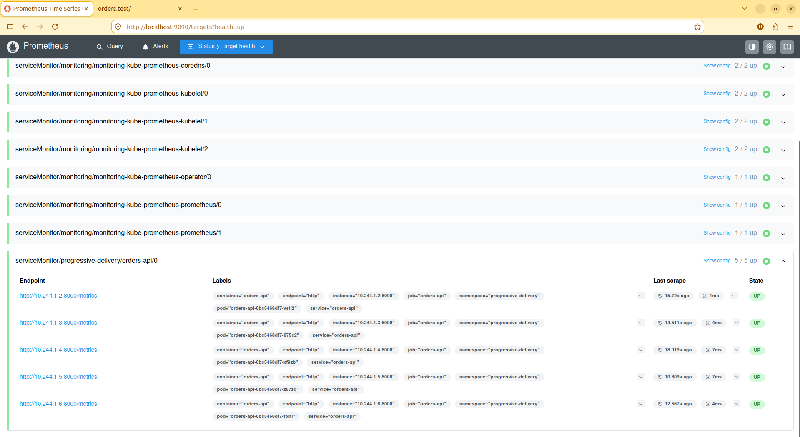


The following command can also be used to inspect the current Pod hashes:

```bash
kubectl get pods \
  -n progressive-delivery \
  -L rollouts-pod-template-hash
```

To confirm that the Pod-template hash is present in Prometheus, run:

```promql
count by (version, rollouts_pod_template_hash) (
  http_requests_total{app="orders-api"}
)
```

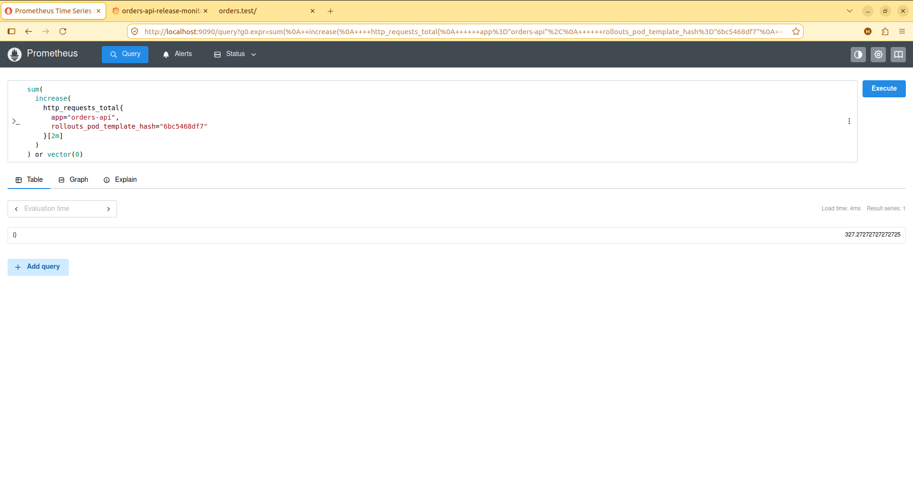


### 14.4 Release Metrics and PromQL

The release dashboard and AnalysisTemplate use the following metrics.

**Request rate by application version:**

```promql
sum by (version) (
  rate(http_requests_total{app="orders-api"}[2m])
)
```

**HTTP 5xx error rate by version, expressed as a fraction:**

```promql
(
  sum by (version) (
    rate(http_requests_total{
      app="orders-api",
      status=~"5.."
    }[2m])
  ) or
  (0 * sum by (version) (
    rate(http_requests_total{app="orders-api"}[2m])
  ))
)
/
sum by (version) (
  rate(http_requests_total{app="orders-api"}[2m])
)
```

The zero-series fallback allows a version with requests but no observed 5xx responses to be represented as zero error rate instead of an absent series.

**P95 request latency by version, in milliseconds:**

```promql
histogram_quantile(
  0.95,
  sum by (version, le) (
    rate(http_request_duration_seconds_bucket{
      app="orders-api"
    }[5m])
  )
) * 1000
```

**Request volume over the last two minutes:**

```promql
sum by (version) (
  increase(http_requests_total{app="orders-api"}[2m])
)
```

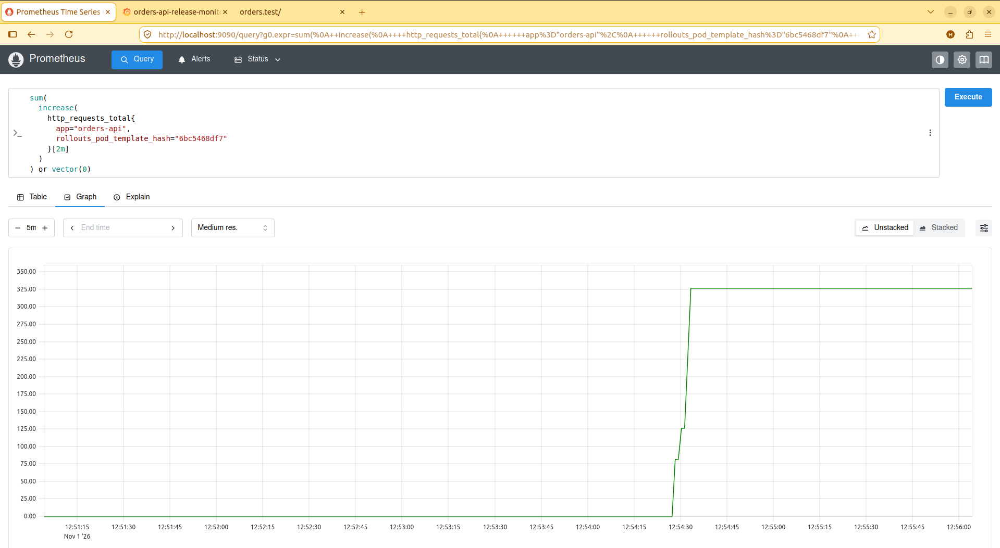

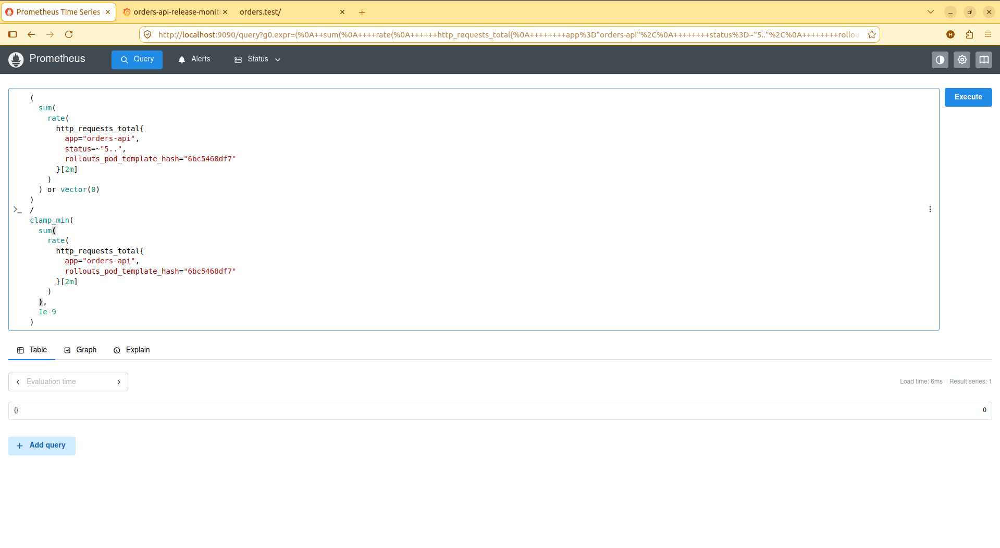

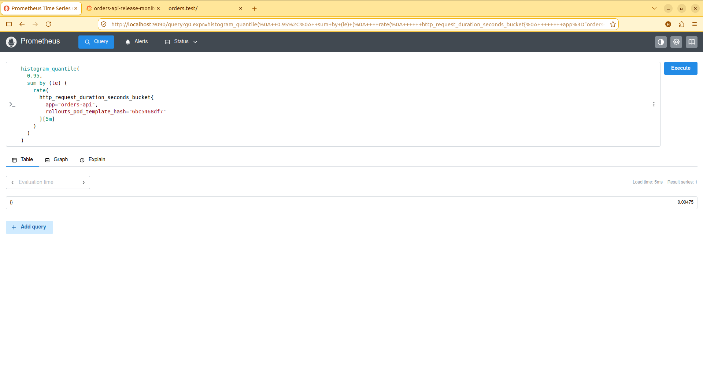

These queries are used for visualization and validation. The AnalysisTemplate uses a candidate-hash selector so it evaluates only the candidate ReplicaSet.

<!-- SCREENSHOT 20 — Prometheus Query Results
Capture the validated PromQL results for request rate, error rate, P95 latency, and request volume. The screenshot can show the query editor and result series.
Save as: docs/images/20-prometheus-query-results.png

-->

### 14.5 Grafana Release Dashboard

A Grafana dashboard named `orders-api-release-monitoring` visualizes the application's release health. It contains four panels:

| Panel | Purpose |
|---|---|
| Request Rate by Version | Compares request throughput for stable and candidate versions |
| HTTP 5xx Error Rate | Displays the proportion of server errors per version |
| P95 Request Latency | Displays the 95th percentile request duration |
| Requests in Last 2 Minutes | Shows request volume and helps identify insufficient traffic |

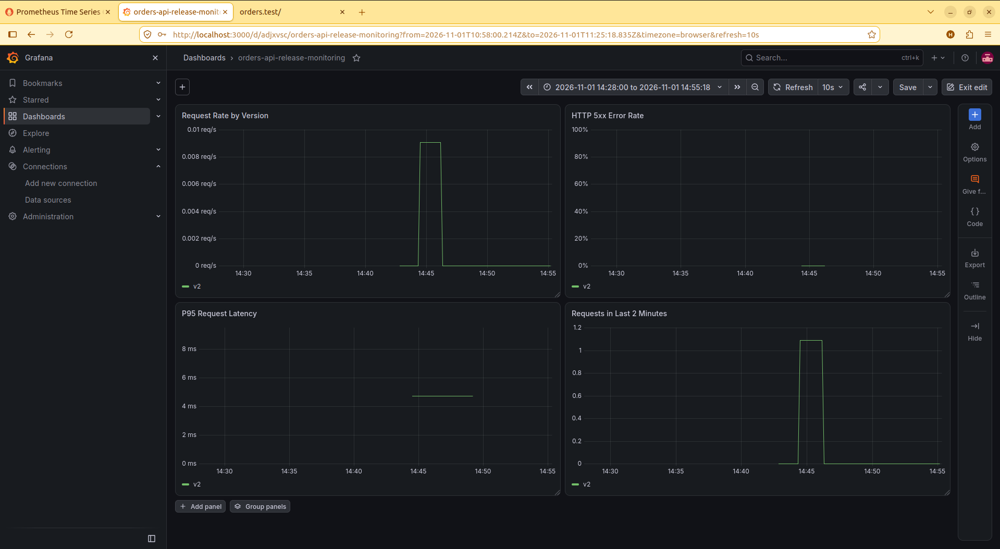


The dashboard uses the Prometheus data source and refreshes every 10 seconds. The exported dashboard JSON can be stored at:

```text
k8s/monitoring/dashboards/orders-api-release-dashboard.json
```

---

## 15. Metric-Driven Release Analysis

### 15.1 AnalysisTemplate

The application release is evaluated by an Argo Rollouts `AnalysisTemplate` stored at:

```text
k8s/analysis/orders-api-analysis.yaml
```

The template receives the candidate's Pod-template hash as an argument. During an inline Analysis step, the Rollout supplies the latest ReplicaSet hash dynamically:

```yaml
args:
  - name: pod-hash
    valueFrom:
      podTemplateHashValue: Latest
```

The corresponding Prometheus label is `rollouts_pod_template_hash`. This avoids hard-coding a version string or ReplicaSet hash in the query and ensures that the analysis is scoped to the candidate being evaluated.

### 15.2 Analysis Criteria

Three metrics are evaluated:

| Metric | Query window / unit | Acceptance condition |
|---|---|---|
| Request volume | `increase()` over 2 minutes | At least 20 requests |
| HTTP 5xx error rate | Fraction over 2 minutes | Less than `0.01` (1%) |
| P95 latency | Seconds over 5 minutes | Less than `0.3` seconds (300 ms) |

The request-volume check prevents an idle candidate from being treated as healthy simply because it has not received enough requests to expose a problem. Insufficient volume is treated as inconclusive rather than as proof of health.

The error-rate and latency checks use candidate-hash filtering. A query with no usable result must not be interpreted as a successful measurement. `Failed` means a measured threshold was violated; `Inconclusive` means the analysis could not establish a valid pass or fail result, for example because the required data was unavailable or insufficient.

The configured analysis uses an initial delay, repeated measurements, and consecutive successful measurements before allowing progression. The actual interval and count are defined in the version-controlled AnalysisTemplate.

### 15.3 Validate the AnalysisTemplate Independently

Before attaching the template to a release, its queries were exercised using a standalone AnalysisRun.

The current stable Pod hash can be inspected with:

```bash
POD=$(kubectl get pods \
  -n progressive-delivery \
  -l app=orders-api \
  -o jsonpath='{.items[0].metadata.name}')

HASH=$(kubectl get pod "$POD" \
  -n progressive-delivery \
  -o jsonpath='{.metadata.labels.rollouts-pod-template-hash}')

echo "$HASH"
```

A standalone AnalysisRun can be created with:

```bash
kubectl argo rollouts create analysisrun \
  --from orders-api-canary-health \
  -n progressive-delivery \
  -a pod-hash="$HASH"
```

Inspect its result:

```bash
kubectl get analysisruns -n progressive-delivery
kubectl describe analysisrun ANALYSIS_RUN_NAME -n progressive-delivery
```

The validation AnalysisRun completed successfully. The `request-volume`, `error-rate`, and `p95-latency` measurements each reported a successful result.


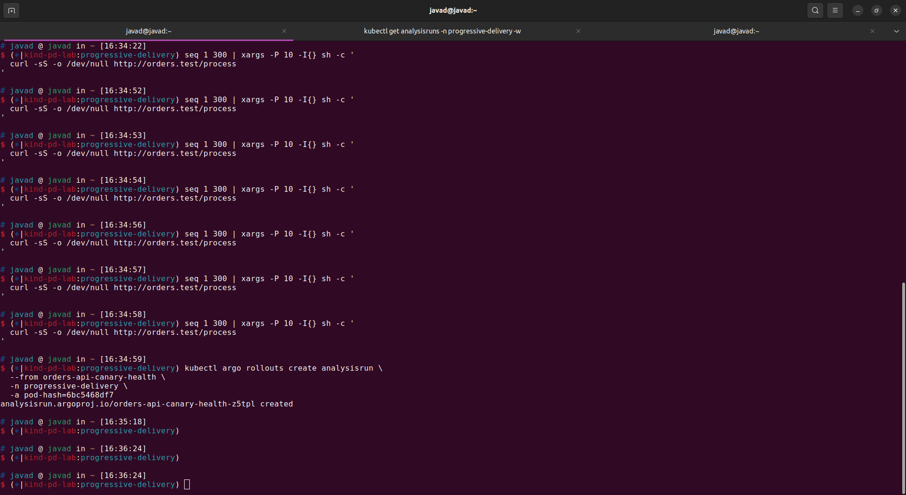

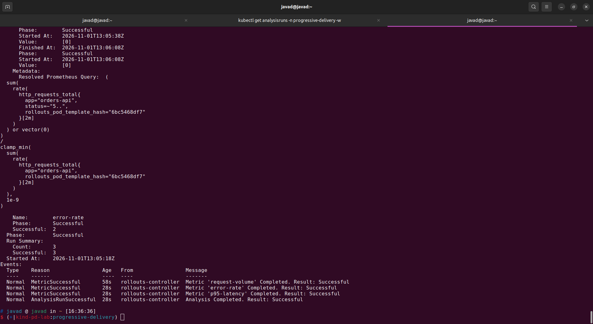


### 15.4 Inline Analysis During Canary Progression

The Rollout invokes the `orders-api-canary-health` AnalysisTemplate after each configured weight:

- 20%
- 40%
- 60%
- 80%

Each Analysis step passes `podTemplateHashValue: Latest` as the `pod-hash` argument. A successful AnalysisRun allows the Rollout to continue to the next weight. A failed AnalysisRun aborts the Canary. An inconclusive result pauses progression for investigation rather than treating the candidate as healthy.

The configured behavior is represented by the following simplified structure:

```yaml
steps:
  - setWeight: 20
  - analysis:
      templates:
        - templateName: orders-api-canary-health
      args:
        - name: pod-hash
          valueFrom:
            podTemplateHashValue: Latest

  - setWeight: 40
  - analysis:
      templates:
        - templateName: orders-api-canary-health
      args:
        - name: pod-hash
          valueFrom:
            podTemplateHashValue: Latest

  - setWeight: 60
  - analysis:
      templates:
        - templateName: orders-api-canary-health
      args:
        - name: pod-hash
          valueFrom:
            podTemplateHashValue: Latest

  - setWeight: 80
  - analysis:
      templates:
        - templateName: orders-api-canary-health
      args:
        - name: pod-hash
          valueFrom:
            podTemplateHashValue: Latest
```

A healthy candidate was released with continuous test traffic. Four inline AnalysisRuns completed successfully, and the candidate was automatically promoted to five ready replicas without manual `promote` commands.

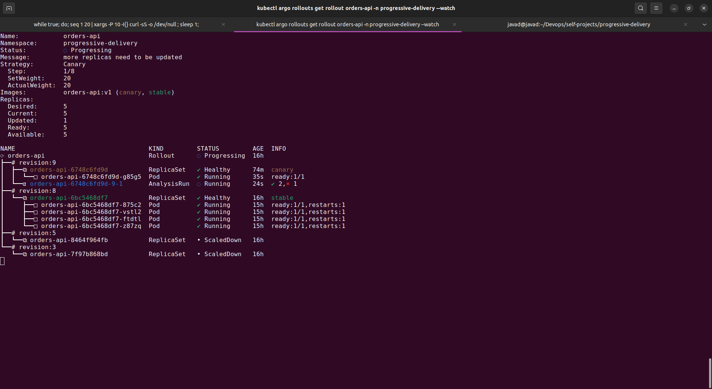
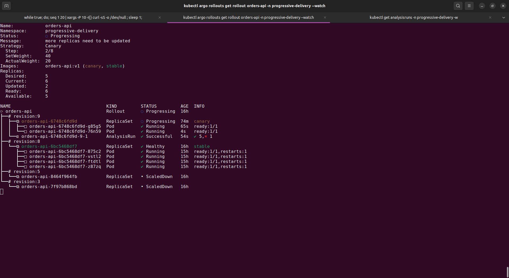
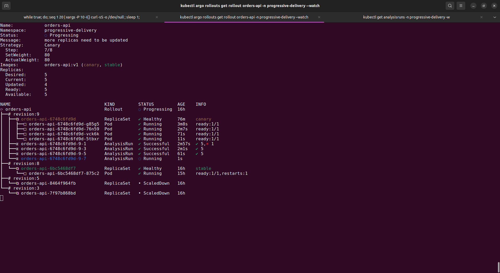


The observed AnalysisRun names were associated with the successful candidate ReplicaSet hash `6748c6fd9d`; all four reported `Successful`.


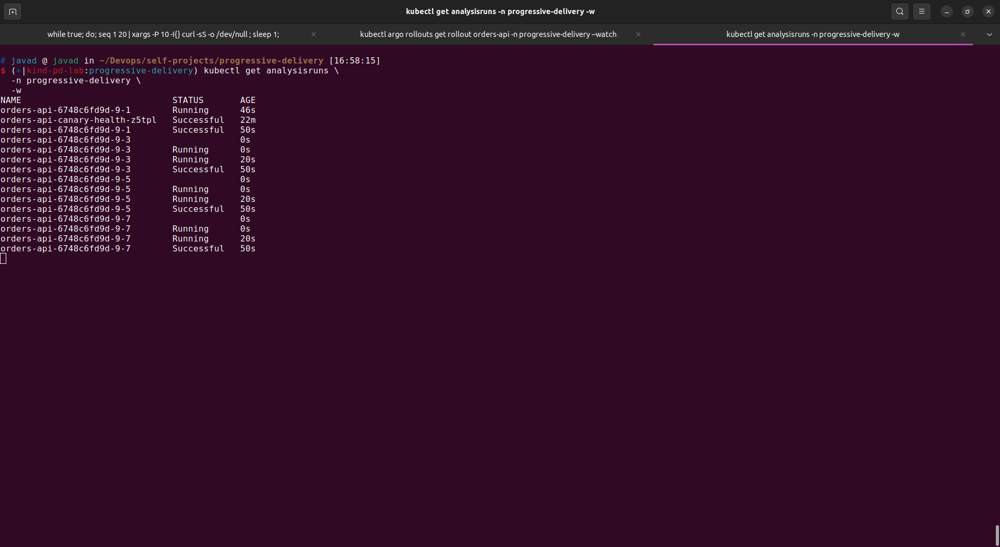

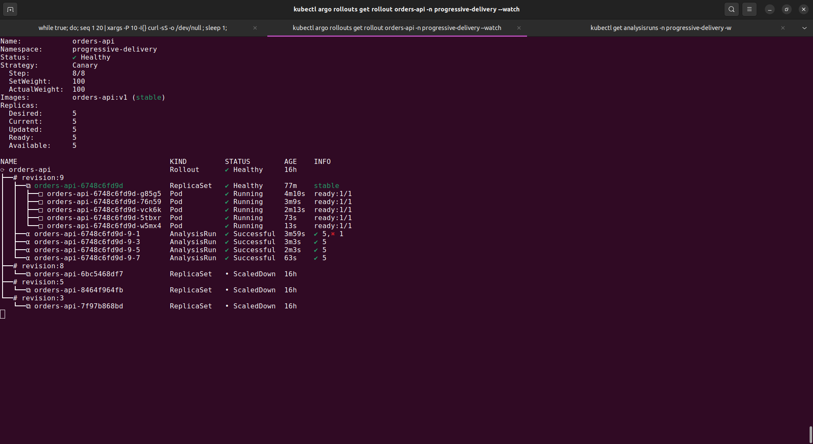

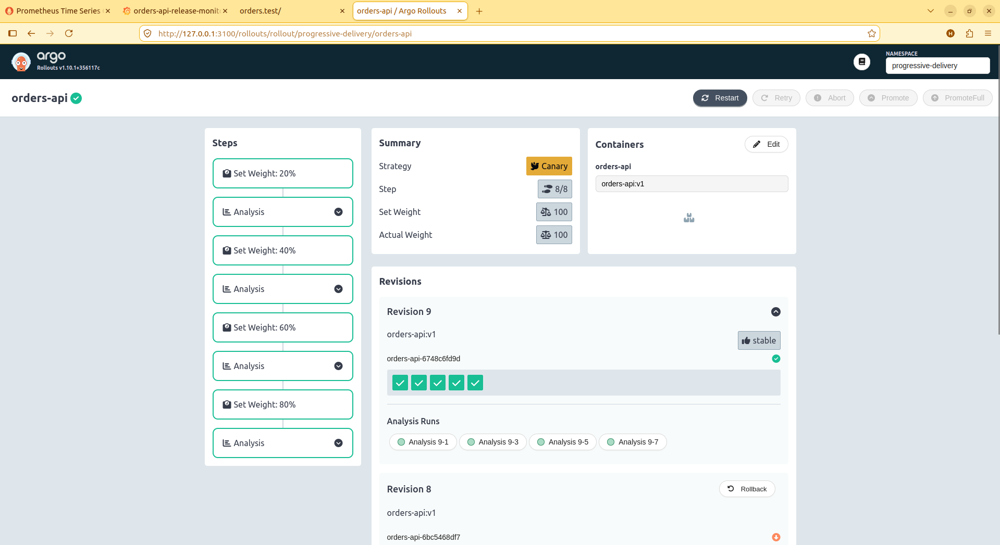

### 15.5 Fault-Injection Test and Automatic Abort

A dedicated fault-injection configuration was created for the candidate version `v4-bad`:

```yaml
data:
  APP_VERSION: "v4-bad"
  ERROR_RATE: "1.0"
  DELAY_MS: "800"
```

The configuration is stored in:

```text
k8s/configmap-v4-bad.yaml
```

A separate candidate Rollout manifest is used for the test:

```text
k8s/scenarios/rollout-v4-bad.yaml
```

The test uses the same image as the other runtime configurations, but changes the candidate environment variables. Test traffic is sent to the application while the candidate is receiving Canary traffic. The Prometheus analysis then evaluates the candidate's own hash-specific metrics.

Apply the fault-injection candidate:

```bash
kubectl apply -f k8s/configmap-v4-bad.yaml
kubectl apply -f k8s/scenarios/rollout-v4-bad.yaml
```

Observe the Rollout and AnalysisRuns:

```bash
kubectl argo rollouts get rollout orders-api \
  -n progressive-delivery --watch

kubectl get analysisruns -n progressive-delivery -w
```

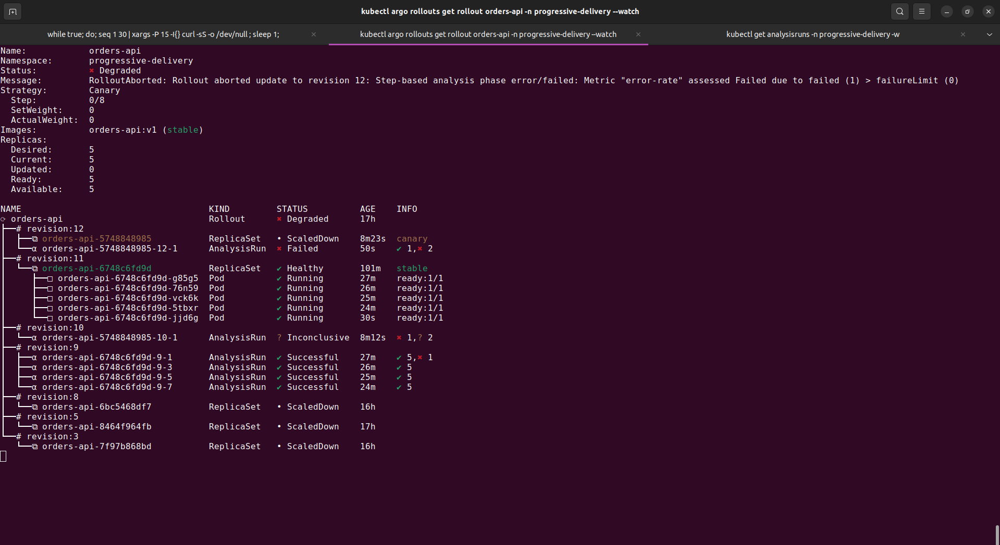


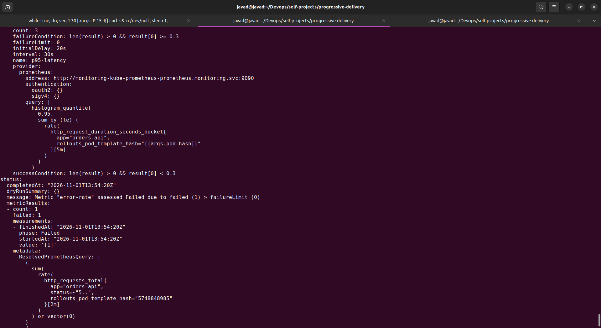


The test produced an inconclusive analysis result during the evaluation sequence and then a failed AnalysisRun for the candidate. The failed metric analysis caused Argo Rollouts to automatically abort the Canary. No manual `kubectl argo rollouts abort` command was used for this test.

The observed AnalysisRun states included:

| Candidate analysis result | Observed status |
|---|---|
| An analysis without a conclusive result | `Inconclusive` |
| The subsequent failed candidate analysis | `Failed` |


### 15.6 Recovery to the Known-Good Version

After the failed candidate was automatically aborted, the stable ReplicaSet remained available. The failed candidate ReplicaSet was scaled to zero. The Rollout's desired Pod template still needed to be reconciled with the known-good configuration, so the normal `k8s/rollout.yaml` manifest, which references `orders-api-v3-config`, was re-applied:

```bash
kubectl apply -f k8s/rollout.yaml
```

This distinction is important: Argo Rollouts automatically aborted the failed Canary and returned serving capacity to the stable ReplicaSet. Re-applying the known-good manifest restored the desired configuration in the declared Rollout spec. The latter step was an explicit operator action; it was not a GitOps reconciliation performed automatically by this environment.

Final verification commands:

```bash
kubectl get rollout orders-api -n progressive-delivery
kubectl get rs -n progressive-delivery
kubectl get analysisruns -n progressive-delivery
kubectl get pods -n progressive-delivery \
  -L rollouts-pod-template-hash
curl -i http://orders.test/version
```
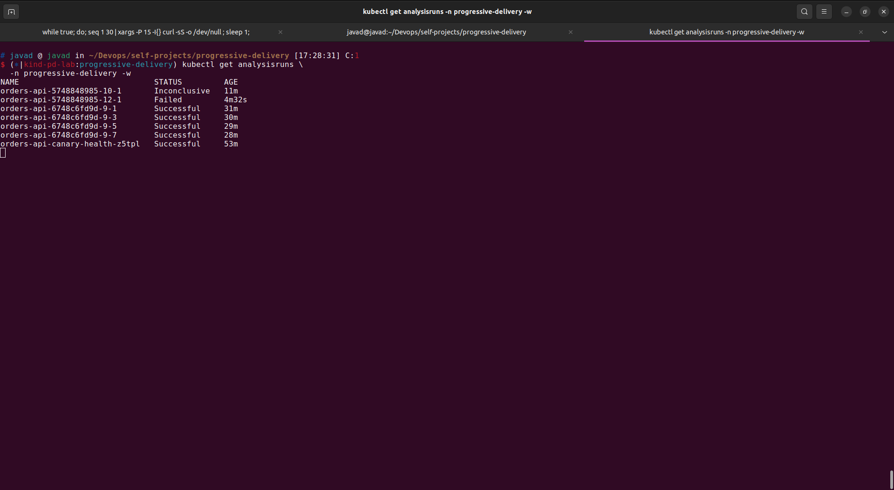

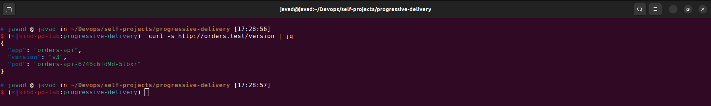

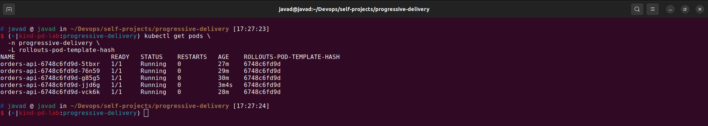

The final observed state was:

| Resource | Observed result |
|---|---|
| `orders-api` Rollout | 5 desired, 5 current, 5 available |
| Stable ReplicaSet | `orders-api-6748c6fd9d`, 5 ready replicas |
| Failed candidate ReplicaSet | `orders-api-5748848985`, 0 replicas |
| Failed candidate AnalysisRun | `Failed` |
| Earlier candidate AnalysisRun | `Inconclusive` |
| Ingress response | HTTP 200, reports `v3` |

The final response from `http://orders.test/version` reported application version `v3`. This validates automatic Canary abort and recovery of serving capacity, followed by restoration of the known-good declared configuration.


The Grafana dashboard after automatic recovery is shown below:

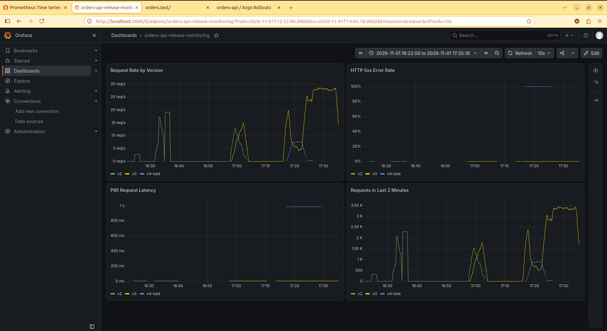

---

## 16. Gateway API Traffic Routing with HAProxy

### 16.1 Why a Separate Traffic-Routing Path Is Used

The original `orders.test` endpoint is preserved through `cloud-provider-kind` and Envoy. A separate HAProxy Gateway API path is used for progressive delivery so that the weighted HTTPRoute can be managed by Argo Rollouts without changing the existing baseline route.

The external hostname for the weighted route is:

```text
orders-haproxy.test
```

All weighted-traffic tests must use this hostname. Requests sent to `orders.test` continue to use the original `orders-api` Service and do not demonstrate the stable/Canary HTTPRoute weights.

### 16.2 HAProxy GatewayClass and Gateway

The HAProxy Gateway API controller is installed from the Community HAProxy Ingress Helm chart. In the verified environment, the chart version is `0.17.0-alpha.2` and the application version is `v0.17.0-alpha.2`.

The Gateway API resources are:

| Kind | Name | Controller / role |
|---|---|---|
| GatewayClass | `haproxy` | `haproxy-ingress.github.io/controller` |
| Gateway | `orders-api-gateway` | HAProxy listener in `progressive-delivery` |
| HTTPRoute | `orders-api-smoke` | Host `orders-haproxy.test` |

The Gateway is expected to report `Programmed=True`. The attached HTTPRoute is expected to report `Accepted=True` and `ResolvedRefs=True`.

Useful inspection commands:

```bash
kubectl get gatewayclass haproxy
kubectl get gateway orders-api-gateway -n progressive-delivery
kubectl describe httproute orders-api-smoke -n progressive-delivery
kubectl get svc haproxy-ingress -n ingress-controller
```

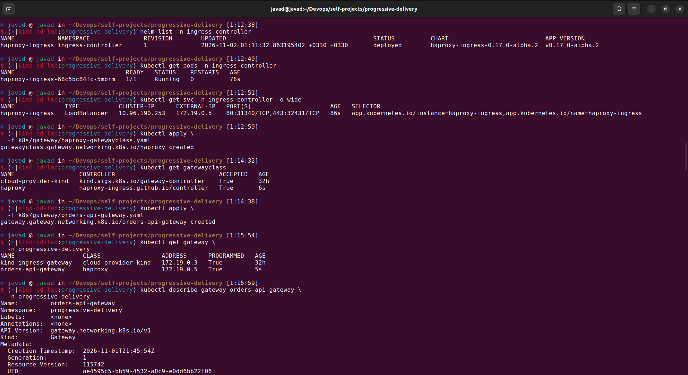

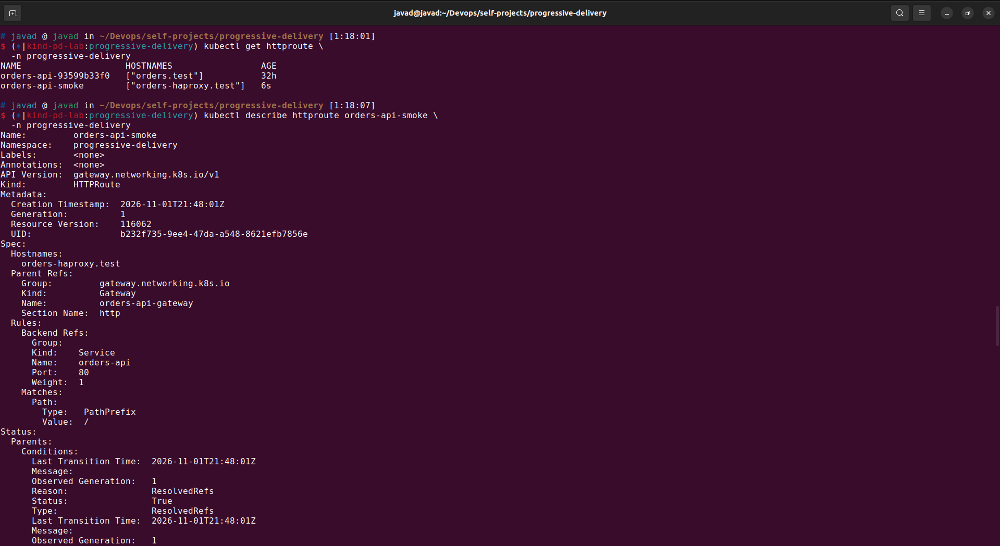

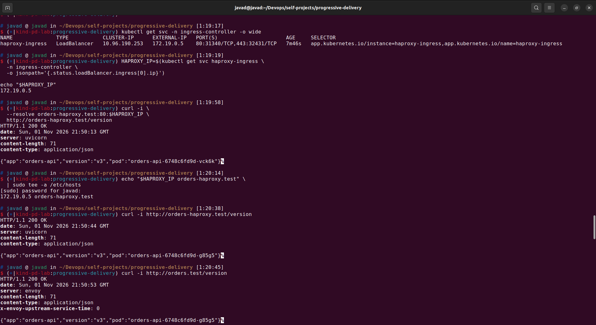


### 16.3 Stable and Canary Services

Two dedicated ClusterIP Services are used by the weighted HTTPRoute:

- `orders-api-stable`
- `orders-api-canary`

Both expose port `80` and forward to the application's named container port `http` (`8000`). Argo Rollouts updates their selectors with the `rollouts-pod-template-hash` label so that each Service selects the appropriate ReplicaSet.

The Services and the updated weighted HTTPRoute are defined in:

```text
k8s/gateway/orders-api-traffic.yaml
```

Apply the stable/Canary Services and weighted Route definition:

```bash
kubectl apply -f k8s/gateway/orders-api-traffic.yaml
```

Inspect the selectors:

```bash
kubectl get svc orders-api-stable orders-api-canary \
  -n progressive-delivery \
  -o jsonpath='{range .items[*]}{.metadata.name}{" => "}{.spec.selector}{"\\n"}{end}'
```
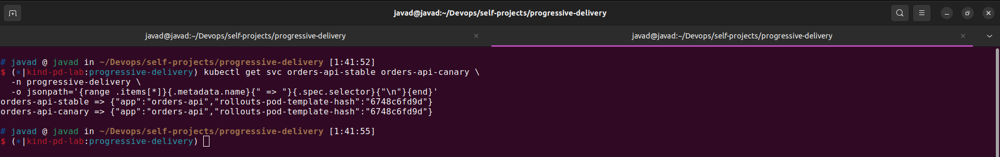

Inspect their EndpointSlices:

```bash
kubectl get endpointslice -n progressive-delivery \
  -l kubernetes.io/service-name=orders-api-stable

kubectl get endpointslice -n progressive-delivery \
  -l kubernetes.io/service-name=orders-api-canary
```
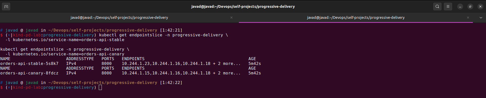

When stable and candidate revisions are distinct, their `rollouts-pod-template-hash` selectors and EndpointSlices should point to different ReplicaSets.


### 16.4 HTTPRoute Backend Weights

The HTTPRoute initially contains both backend references with all traffic directed to the stable Service:

```yaml
backendRefs:
  - name: orders-api-stable
    kind: Service
    port: 80
    weight: 100
  - name: orders-api-canary
    kind: Service
    port: 80
    weight: 0
```

As the Rollout advances, the Gateway API plugin changes these weights to match the active Canary step. The expected sequence is:

| Canary step | Stable weight | Canary weight |
|---:|---:|---:|
| Initial stable | 100 | 0 |
| 20% | 80 | 20 |
| 40% | 60 | 40 |
| 60% | 40 | 60 |
| 80% | 20 | 80 |
| Fully promoted | 100 (new stable) | 0 |

The current Route weights can be inspected with:

```bash
kubectl get httproute orders-api-smoke \
  -n progressive-delivery \
  -o jsonpath='{range .spec.rules[*].backendRefs[*]}{.name}{" = "}{.weight}{"\\n"}{end}'
```
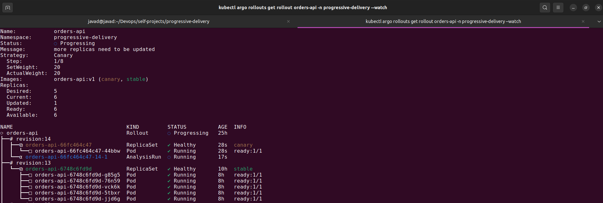

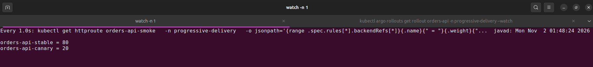

The route must be tested through `http://orders-haproxy.test/version`:

```bash
curl -i http://orders-haproxy.test/version
```

### 16.5 Argo Rollouts Gateway API Traffic Plugin

The Gateway API traffic-routing plugin connects the Argo Rollouts controller to the HAProxy HTTPRoute. The plugin release used in this environment is `v0.17.0`.

The plugin is registered through the `argo-rollouts-config` ConfigMap in the `argo-rollouts` namespace:

```yaml
apiVersion: v1
kind: ConfigMap
metadata:
  name: argo-rollouts-config
  namespace: argo-rollouts
data:
  trafficRouterPlugins: |-
    - name: "argoproj-labs/gatewayAPI"
      location: "https://github.com/argoproj-labs/rollouts-plugin-trafficrouter-gatewayapi/releases/download/v0.17.0/gatewayapi-plugin-linux-amd64"
```

The controller downloads the plugin binary during startup. After updating the plugin ConfigMap, restart the controller and verify the download in its logs:

```bash
kubectl rollout restart deployment/argo-rollouts -n argo-rollouts

kubectl rollout status deployment/argo-rollouts \
  -n argo-rollouts

kubectl logs deployment/argo-rollouts \
  -n argo-rollouts --since=10m | \
  grep -i -E 'plugin|gatewayapi|download'
```

The log should contain a successful download message for `argoproj-labs/gatewayAPI`.

The plugin requires permission to read Services and to read/update/patch HTTPRoutes in the application namespace. A namespace-scoped Role and RoleBinding are defined in:

```text
k8s/gateway/argo-rollouts-gateway-rbac.yaml
```

The Role grants `get` on core `services` and `get`, `update`, and `patch` on `gateway.networking.k8s.io/httproutes`. Its RoleBinding grants those permissions to the Argo Rollouts controller ServiceAccount in the `argo-rollouts` namespace.

The permissions can be checked with:

```bash
SA="system:serviceaccount:argo-rollouts:argo-rollouts"

kubectl auth can-i get services \
  -n progressive-delivery --as="$SA"

kubectl auth can-i get httproutes.gateway.networking.k8s.io \
  -n progressive-delivery --as="$SA"

kubectl auth can-i update httproutes.gateway.networking.k8s.io \
  -n progressive-delivery --as="$SA"

kubectl auth can-i patch httproutes.gateway.networking.k8s.io \
  -n progressive-delivery --as="$SA"
```

All four checks should return `yes`.

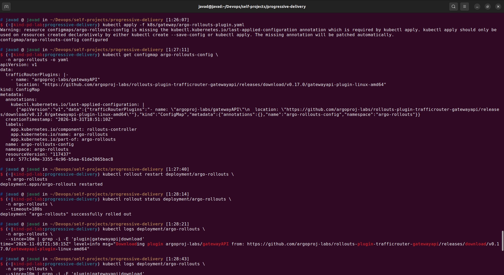

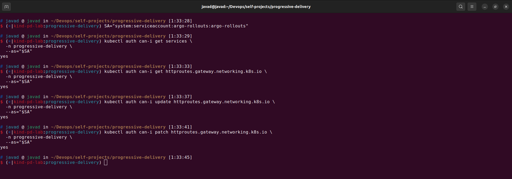

The active Rollout references the plugin as follows:

```yaml
strategy:
  canary:
    stableService: orders-api-stable
    canaryService: orders-api-canary
    trafficRouting:
      plugins:
        argoproj-labs/gatewayAPI:
          httpRoute: orders-api-smoke
          namespace: progressive-delivery
```

---

## 17. k6 Load Testing and Traffic-Split Validation

### 17.1 Test Objective

k6 is used to generate a controlled request arrival rate through the HAProxy Gateway and to verify which application version serves each request. The test provides evidence that the HTTPRoute weights affect real requests, rather than merely showing the configured backend weights.

The k6 scenario is stored in:

```text
k6/traffic-split.js
```

The test sends requests to `/version` through `orders-haproxy.test`. It reads the version field from each successful response and counts stable, Canary, and unknown-version responses separately.

### 17.2 Constant Arrival Rate Scenario

The scenario uses the `constant-arrival-rate` executor. Its main settings are:

| Setting | Default / example | Purpose |
|---|---:|---|
| `RATE` | `10` iterations per second | Target request arrival rate |
| `DURATION` | `60s` | Test duration; extended to `500s` for the full release validation |
| `preAllocatedVUs` | `5` | Initial VU allocation |
| `maxVUs` | `20` | Maximum VUs available to sustain the target rate |
| `BASE_URL` | `http://orders-haproxy.test` | HAProxy route under test |
| `STABLE_VERSION` | `v4` in the first v4-to-v5 test | Expected stable response version |
| `CANARY_VERSION` | `v5` in the first v4-to-v5 test | Expected candidate response version |

The test is run while the Rollout is at a known Canary weight. The hostname must resolve to the HAProxy LoadBalancer address on the Ubuntu host.

### 17.3 k6 Thresholds

The script defines thresholds so that a test failure is reported through k6's exit status:

| Metric / check | Threshold | Meaning |
|---|---|---|
| `http_req_failed` | `rate<0.01` | Fewer than 1% failed HTTP requests |
| `http_req_duration` | `p(95)<500` | P95 HTTP request duration below 500 ms |
| `checks` | `rate>0.99` | More than 99% of response checks pass |
| `dropped_iterations` | `count==0` | No scheduled iterations are dropped |
| `unknown_version_responses` | `count==0` | Every successful response maps to a known version |

When a threshold is not met, k6 exits with a non-zero exit code. This makes the test suitable for automated validation as well as manual experiments.

### 17.4 Run k6 with Docker

The k6 container uses host networking to reach the LoadBalancer address exposed by the local kind environment. The hostname is explicitly mapped into the container:

```bash
docker run --rm \
  --network host \
  --add-host=orders-haproxy.test:172.19.0.5 \
  -v "$PWD/k6:/scripts:ro" \
  -e BASE_URL=http://orders-haproxy.test \
  -e STABLE_VERSION=v4 \
  -e CANARY_VERSION=v5 \
  -e RATE=10 \
  -e DURATION=60s \
  grafana/k6:latest run /scripts/traffic-split.js
```

The `172.19.0.5` address is the observed HAProxy LoadBalancer address in the local environment. It can change if the cluster or LoadBalancer integration is recreated; check the current Service address and update the host mapping when necessary.

For the sustained release validation, the same command was executed with a 500-second duration:

```bash
docker run --rm \
  --network host \
  --add-host=orders-haproxy.test:172.19.0.5 \
  -v "$PWD/k6:/scripts:ro" \
  -e BASE_URL=http://orders-haproxy.test \
  -e STABLE_VERSION=v4 \
  -e CANARY_VERSION=v5 \
  -e RATE=10 \
  -e DURATION=500s \
  grafana/k6:latest run /scripts/traffic-split.js
```
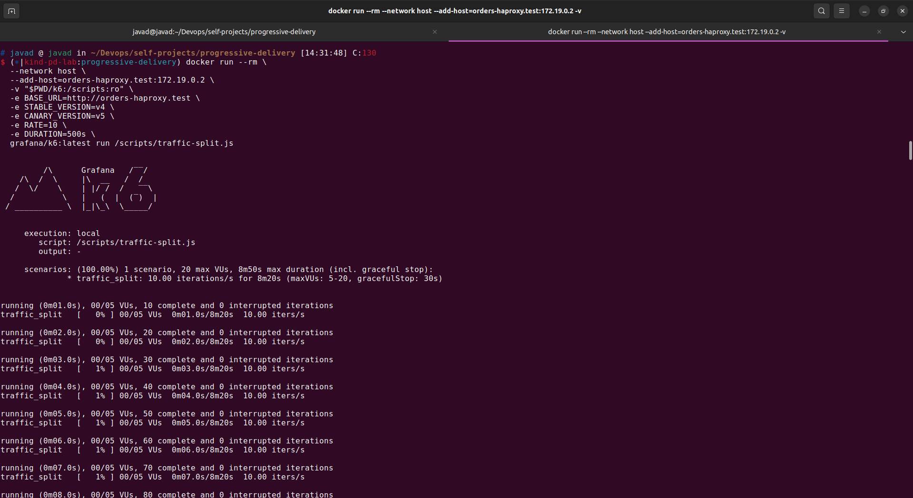


### 17.5 Verify the Actual Traffic Distribution

At the 20% Canary stage, a 60-second run at 10 iterations per second produced the following observed counters:

| Counter | Requests | Share |
|---|---:|---:|
| `stable_responses` (v4) | 482 | 80.33% |
| `canary_responses` (v5) | 118 | 19.67% |
| `unknown_version_responses` | 0 | 0% |
| **Total** | **600** | **100%** |

The observed distribution closely matched the configured 80/20 HTTPRoute weights. This confirmed that the HAProxy Gateway path was applying request-level traffic splitting.
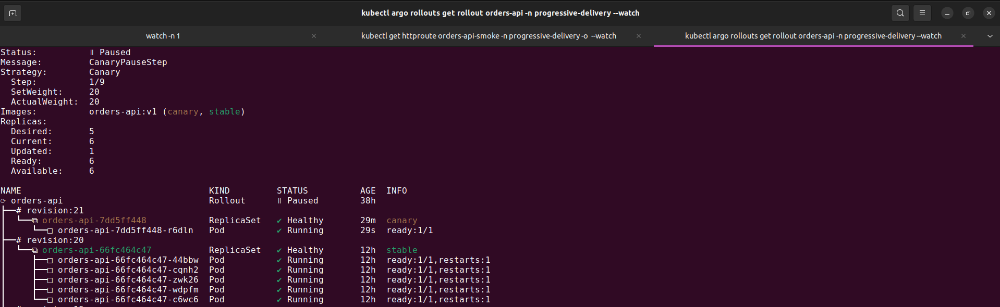


The Canary share can be calculated from the k6 counters:

```text
Canary percentage =
  canary_responses /
  (stable_responses + canary_responses) * 100
```


The exact counts vary between runs because requests are distributed over time; the test is expected to approximate the configured weights over a sufficiently large sample.

<!-- SCREENSHOT 34 — k6 20 Percent Traffic Split
Capture k6 output with stable_responses=482, canary_responses=118, and unknown_version_responses=0 (or the latest equivalent run).
Save as: docs/images/34-k6-traffic-split-20-percent.png

-->

### 17.6 Sustained Load for Prometheus Analysis

The AnalysisTemplate evaluates request volume using an `increase()` query over a two-minute window and requires at least 20 candidate requests. Error rate and P95 latency are also evaluated against the candidate Pod-template hash.

A short traffic test can verify the 20% split but may not provide enough fresh request samples when the Rollout reaches later Canary stages. The load test was therefore extended to 500 seconds so that request traffic continued while the Rollout advanced through 20%, 40%, 60%, and 80% and the corresponding AnalysisRuns executed.

The sustained test completed successfully. All four AnalysisRuns for revision 21 reported `Successful`, and the Rollout became `Healthy` with five ready Pods. This addressed the earlier `request-volume` Analysis failure caused by insufficient candidate traffic in the two-minute measurement window.


### 17.7 End-to-End Release Verification

The combined validation sequence is:

1. Apply a healthy candidate runtime configuration and update the Rollout Pod template.
2. Confirm that Argo Rollouts creates a new candidate ReplicaSet.
3. Confirm that stable and Canary Service selectors point to the appropriate Rollout hashes.
4. Verify that the `orders-api-smoke` HTTPRoute weight changes at each Canary step.
5. Run k6 against `orders-haproxy.test` and compare observed response counts with the configured weights.
6. Keep sufficient traffic flowing while Prometheus evaluates request volume, HTTP 5xx error rate, and P95 latency for the candidate hash.
7. Confirm that all four AnalysisRuns succeed and the candidate is promoted automatically.
8. Confirm that the final Rollout is `Healthy`, has five ready Pods, and the new version is served as the stable release.

The latest successful run reached revision 21. The active ReplicaSet was `orders-api-7dd5ff448`, with five ready Pods; the four associated AnalysisRuns were all successful. The stable runtime configuration was v5.

<!-- SCREENSHOT 35 — Sustained k6 Run
Capture the k6 500-second run and its final summary, including HTTP failure rate, P95 latency, and custom response counters.
Save as: docs/images/35-k6-sustained-load.png

-->

<!-- SCREENSHOT 36 — Successful End-to-End Rollout
Capture `kubectl argo rollouts get rollout orders-api -n progressive-delivery` showing revision 21, Healthy status, five ready Pods, and four Successful AnalysisRuns.
Save as: docs/images/36-e2e-rollout-healthy.png

-->

---

## 18. Current Limitations

The current implementation is a local lab intended to demonstrate progressive delivery, weighted request routing, and metric-driven release decisions. The following limitations remain:

- v1 through v5 are currently represented by runtime configurations of the same `orders-api:v1` image. They are not separate immutable application builds.
- The kind environment has one worker node for application scheduling and is not a highly available production cluster.
- The Prometheus and Grafana installation is intentionally lightweight. Alertmanager, Node Exporter, and kube-state-metrics are disabled; Prometheus retention is limited and no persistent volume is configured.
- The histogram does not include an endpoint-path label. Its P95 represents the instrumented application requests collectively, excluding `/healthz`, `/readyz`, and `/metrics`; it is not an isolated `/process` latency measurement.
- The AnalysisTemplate evaluates request volume, HTTP 5xx error rate, and P95 latency. It does not yet analyze CPU, memory, saturation, dependency health, or business-level success metrics.
- The k6 scenario validates HTTP response distribution and request-level performance for the configured test. It does not represent a full production traffic model or a long-term capacity benchmark.
- The application does not use an external database or other stateful dependencies.
- `/healthz` and `/readyz` currently return successful responses unconditionally because the sample application has no external dependencies to check.
- The original `orders.test` path through Envoy is intentionally separate from the weighted `orders-haproxy.test` path. Traffic-split results are valid only when requests reach the HAProxy HTTPRoute.
- After an automatic Canary Abort, Argo Rollouts restores serving capacity to the stable ReplicaSet, but restoring the desired Rollout template to a known-good configuration remains an explicit manifest reconciliation step in this lab.

These limitations define possible future improvements while keeping the current implementation focused on the verified Gateway API, HAProxy, Argo Rollouts, Prometheus, and k6 integration.

---

## 19. Ongoing Development

The platform is being extended continuously. The implemented capabilities form the current baseline; future work can build on the same application, Kubernetes cluster, monitoring stack, Gateway API configuration, and Rollout definitions.

### Implemented capabilities

- FastAPI application with configurable version identity, error injection, and processing delay.
- Docker packaging and execution with configurable runtime environment variables.
- Two-node local Kubernetes cluster using kind.
- Kubernetes Service and external HTTP access through the original Ingress, Gateway API, and Envoy path.
- HAProxy Community Ingress Controller installed as a Gateway API implementation.
- HAProxy GatewayClass, Gateway, and HTTPRoute for `orders-haproxy.test`.
- Argo Rollouts Gateway API plugin installation and controller registration.
- Namespace-scoped RBAC for the Argo Rollouts controller to manage the target HTTPRoute.
- Dedicated stable and Canary Services selected by Rollout Pod-template hash.
- Request-level weighted HTTP traffic routing at 20%, 40%, 60%, and 80% Canary stages.
- Prometheus Operator, Prometheus, and Grafana installation through Helm.
- Per-Pod scraping using ServiceMonitor, including the Rollout Pod-template hash label.
- Grafana dashboard for request rate, 5xx error rate, P95 latency, and request volume.
- Argo Rollouts AnalysisTemplate and AnalysisRuns backed by Prometheus queries.
- Automatic Canary abort after failed metric analysis and recovery to the stable ReplicaSet.
- k6 Constant Arrival Rate load testing with response-version counters and thresholds.
- Validation of actual request distribution against HTTPRoute backend weights.
- Sustained 500-second test traffic to support request-volume analysis throughout Canary progression.
- Automatic promotion of a healthy candidate after all four AnalysisRuns complete successfully.

### Possible improvements

- Build separate immutable application images for actual software revisions instead of using one image with different runtime labels.
- Improve metrics instrumentation with route-level dimensions and explicit business-operation metrics while controlling label cardinality.
- Add infrastructure and application saturation signals to release analysis.
- Add durable storage and a more production-like monitoring topology when the environment is moved beyond a local kind cluster.
- Expand the k6 scenarios with additional arrival profiles, longer soak tests, and controlled fault conditions.
- Evaluate GitOps reconciliation for declarative recovery of the desired Rollout state after an aborted release.

---

## 20. Conclusion

The environment now provides a working progressive-delivery lab with request-level weighted traffic routing. A configurable FastAPI service is containerized and deployed to a two-node kind cluster. The original external access path through `cloud-provider-kind` and Envoy remains available, while a separate HAProxy Gateway API path is used for Canary traffic management.

Argo Rollouts manages the application ReplicaSets and coordinates traffic progression through its Gateway API plugin. The plugin updates the HAProxy HTTPRoute backend weights and the stable/Canary Service selectors target the corresponding ReplicaSets. Prometheus scrapes each application Pod and retains the Rollout Pod-template hash, while Grafana presents release-focused metrics. An AnalysisTemplate evaluates request volume, HTTP 5xx error rate, and P95 latency for the candidate ReplicaSet.

The k6 Constant Arrival Rate test verified the actual request distribution at the 20% Canary stage: 118 responses came from v5 and 482 from v4, with no unknown-version responses. A sustained 500-second test provided enough traffic for all four Prometheus-backed AnalysisRuns to pass. The latest observed Rollout reached revision 21 and `Healthy` status, with five ready Pods and v5 as the stable runtime configuration.

The project currently demonstrates the complete path from a candidate runtime configuration through Gateway API traffic splitting, load generation, metric-based evaluation, and automatic promotion. Fault-injection experiments also demonstrated automatic Canary Abort and restoration of serving capacity to the stable ReplicaSet.
